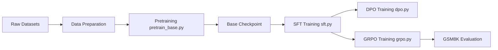

# FareedKhan-dev/train-llm-from-scratch

> Executable tutorial that trains a small LLM in pure PyTorch, from pre-training to GRPO.

## The problem
Tutorials often stop at pre-training or hide post-training behind `trl`/`peft`. It is hard to see SFT, reward model, PPO, DPO and GRPO on a single model.

## What it actually does
A hand-written Transformer (`src/models/`), `r50k_base` tokenization to HDF5, pre-training (`pretrain_base.py`, DDP, bf16), then SFT with loss masking, Bradley-Terry reward model, DPO/ORPO/KTO, PPO with GAE and GRPO on GSM8K. Evaluation by GSM8K accuracy, CLI chat, Streamlit panel, per-stage JSON configs and `smoke` variants that run on CPU.

## How it is wired


## Trying it
```bash
git clone https://github.com/FareedKhan-dev/train-llm-from-scratch.git
cd train-llm-from-scratch
pip install -e .
python scripts/train_transformer.py
python tests/test_post_training_smoke.py
streamlit run ui/app.py
```

## Cost and gotchas
GPU required: a T4 is enough for 13M parameters, not for the billion. The README runs were done on 2× L40; downloads an excerpt of The Pile.

## What it is not
Not a production library nor a usable model: the 13M model produces barely coherent text. The reward model plateaus at 0.574 accuracy.

## Alternatives
No alternative named in the README.

## For you
To adopt as a learning resource: every post-training algorithm is hand-written, readable and testable in a few seconds thanks to the `smoke` configs, which genuinely helps in understanding DPO or GRPO.
