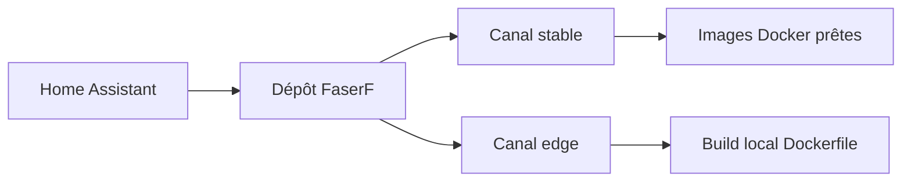

# FaserF/hassio-addons

> Repository of Home Assistant apps maintained by an individual, with stable and edge channels.

## The problem
Home Assistant does not offer side services (web servers, DNS, PDF, bots) installable in one click out of the box.

## What it actually does
A catalog of apps (Apache2, NGINX, Wiki.js, ShieldDNS, WhatsApp, Planka and others) to add as a repository in Home Assistant. The stable channel offers ready-made images; the edge channel builds the apps under development locally. The README also lists Home Assistant integrations by the same author, some archived.

## How it is wired
Simplified diagram based on the sheet, no diagram provided.



## Trying it
```text
https://github.com/FaserF/hassio-addons
https://github.com/FaserF/hassio-addons#edge
```
To add under Settings, Add-ons, Store, Repositories.

## Cost and gotchas
A Home Assistant installation is needed. The edge channel builds on your device, slower and more resource-hungry. The author says use is primarily private: support is not guaranteed.

## What it is not
Not a supported product: several apps are in beta or marked unmaintained. Not related to data or AI, apart from a few side apps.

## Alternatives
No alternative named in the README.

## For you
Ignore: serves personal home automation, with hobby-level support and no link to your profession.
