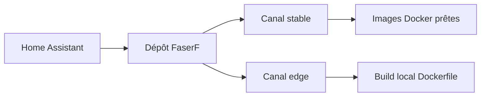

# FaserF/hassio-addons

> Dépôt d'apps Home Assistant maintenues par un particulier, avec canaux stable et edge.

## Le problème
Home Assistant ne propose pas d'office des services annexes (serveurs web, DNS, PDF, bots) installables en un clic.

## Ce que ça fait vraiment
Un catalogue d'apps (Apache2, NGINX, Wiki.js, ShieldDNS, WhatsApp, Planka et d'autres) à ajouter comme dépôt dans Home Assistant. Le canal stable propose des images prêtes ; le canal edge compile localement les apps en développement. Le README liste aussi des intégrations Home Assistant du même auteur, certaines archivées.

## Comment c'est branché
Schéma simplifié d'après la fiche, sans diagramme fourni.



## Essayer
```text
https://github.com/FaserF/hassio-addons
https://github.com/FaserF/hassio-addons#edge
```
À ajouter dans Paramètres, Add-ons, Boutique, Dépôts.

## Coût et pièges
Une installation Home Assistant est nécessaire. Le canal edge compile sur ton appareil, plus lent et plus gourmand. L'auteur dit l'usage d'abord privé : support non garanti.

## Ce que ce n'est pas
Pas un produit supporté : plusieurs apps sont en bêta ou marquées non maintenues. Pas lié à la data ni à l'IA, hormis quelques apps annexes.

## Alternatives
Aucune alternative nommée dans le README.

## Pour toi
À ignorer : sert à la domotique personnelle, avec un support de loisir et sans lien avec ton métier.

