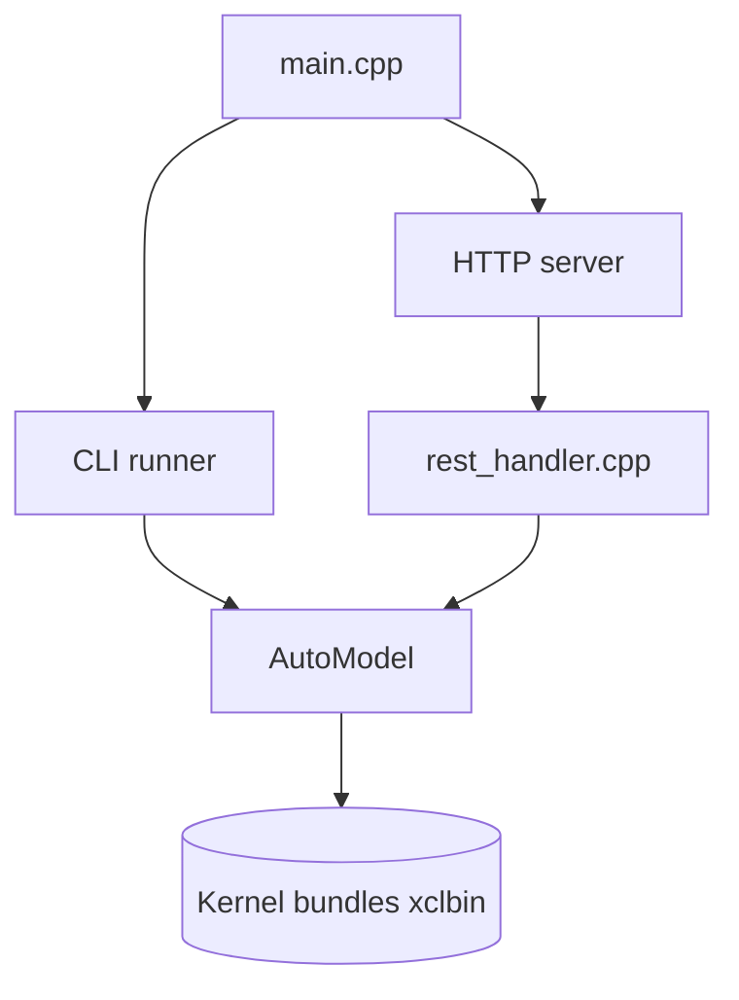

# FastFlowLM/FastFlowLM

> LLM inference runtime on AMD Ryzen AI NPU, with a CLI and an OpenAI-compatible server.

## The problem
Running an LLM locally without a GPU, taking advantage of the NPU in Ryzen AI chips, is poorly tooled.

## What it actually does
A C++ executable loads NPU kernels specific to each model and runs inference through the CLI (`flm run`) or as an OpenAI-compatible REST server (port 52625). It handles text, vision, audio (Whisper), embeddings and MoE, up to 256k of context according to the README.

## How it is wired
Diagram based on the provided diagram.



## Trying it
```bash
flm run llama3.2:1b
flm serve llama3.2:1b
flm list
```

## Cost and gotchas
Ryzen AI XDNA2 chip and NPU driver 32.0.203.311 or later; models downloaded from HuggingFace. License not identified by GitHub.

## What it is not
Not multi-hardware: AMD Ryzen AI only. The "10 times more efficient" claims come from the README, with no measurement verified here.

## Alternatives
No alternative named in the README.

## For you
Worth watching if you have a Ryzen AI PC: efficient local inference, but an unclear license and very specific hardware.
