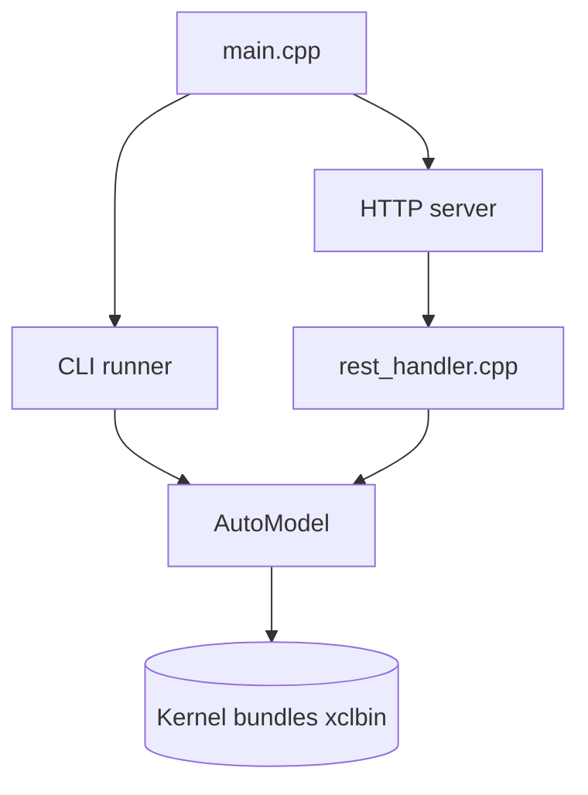

# FastFlowLM/FastFlowLM

> Runtime d'inférence de LLM sur NPU AMD Ryzen AI, avec CLI et serveur compatible OpenAI.

## Le problème
Faire tourner un LLM en local sans GPU en profitant du NPU des puces Ryzen AI est mal outillé.

## Ce que ça fait vraiment
Un exécutable C++ charge des noyaux NPU propres à chaque modèle et exécute l'inférence en CLI (`flm run`) ou en serveur REST compatible OpenAI (port 52625). Il gère texte, vision, audio (Whisper), embeddings et MoE, jusqu'à 256k de contexte selon le README.

## Comment c'est branché
Schéma d'après le diagramme fourni.



## Essayer
```bash
flm run llama3.2:1b
flm serve llama3.2:1b
flm list
```

## Coût et pièges
Puce Ryzen AI XDNA2 et pilote NPU 32.0.203.311 ou plus ; modèles téléchargés depuis HuggingFace. Licence non identifiée par GitHub.

## Ce que ce n'est pas
Pas multi-matériel : AMD Ryzen AI uniquement. Les « 10 fois plus économe » viennent du README, sans mesure vérifiée ici.

## Alternatives
Aucune alternative nommée dans le README.

## Pour toi
À surveiller si tu as un PC Ryzen AI : inférence locale économe, mais licence floue et matériel très spécifique.

