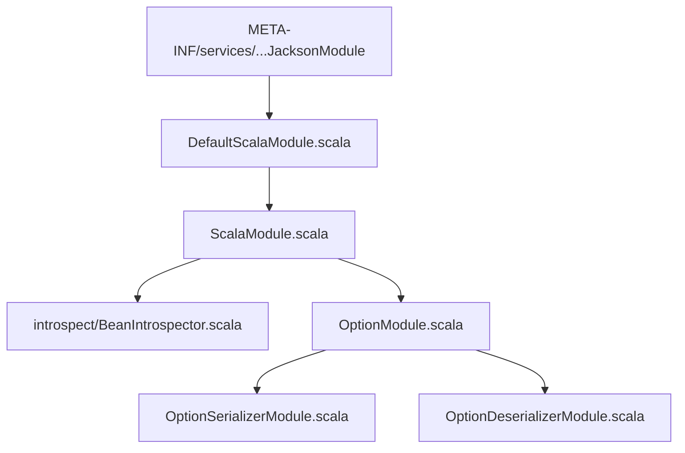

# FasterXML/jackson-module-scala

> Jackson module that serializes and deserializes Scala types (case classes, Option, Map, tuples, enumerations).

## The problem
Jackson, designed for Java, does not understand Scala collections or properties by default.

## What it actually does
Registered in the `ObjectMapper`, `DefaultScalaModule` assembles per-type modules (Option, Tuple...), each with its own serializer and deserializer, while `BeanIntrospector` reads the classes' properties. It also handles Scala 3 `enum`s and sealed hierarchies.

## How it is wired


## Trying it
```bash
# build.sbt
libraryDependencies += "tools.jackson.module" %% "jackson-module-scala" % "3.1.2"
```

## Cost and gotchas
Free. You need the JVM and sbt. Deserialization remains limited: primitives such as `Option[Long]` may be read as `Integer` without an annotation or `derives ScalaTypeInfo`. A few tests still fail in Scala 3.

## What it is not
Not a standalone JSON parser: it extends Jackson and does not work without it.

## Alternatives
No alternative named in the README.

## For you
Ignore, unless you do Scala/Spark: then it is the standard module for going from JSON to case classes.
