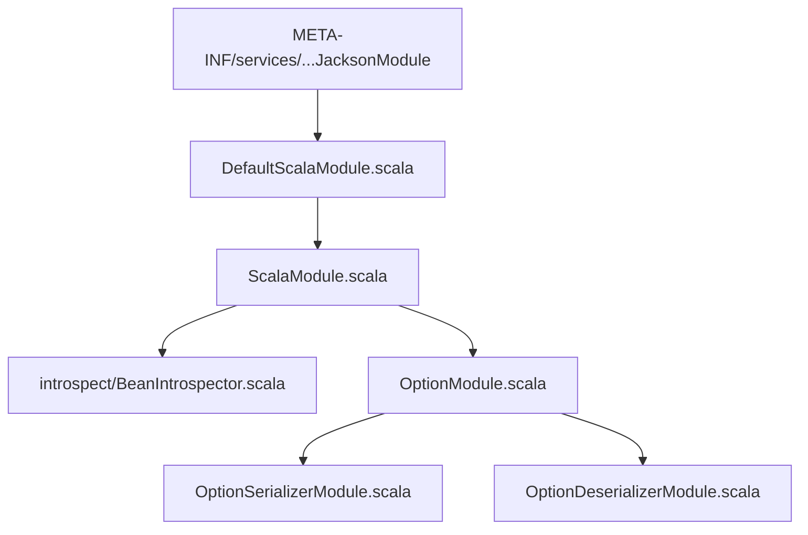

# FasterXML/jackson-module-scala

> Module Jackson qui sérialise et désérialise les types Scala (case classes, Option, Map, tuples, énumérations).

## Le problème
Jackson, pensé pour Java, ne comprend pas les collections ni les propriétés Scala par défaut.

## Ce que ça fait vraiment
Enregistré dans l'`ObjectMapper`, `DefaultScalaModule` assemble des modules par type (Option, Tuple...), chacun avec son sérialiseur et son désérialiseur, tandis que `BeanIntrospector` lit les propriétés des classes. Il gère aussi les `enum` de Scala 3 et les hiérarchies scellées.

## Comment c'est branché


## Essayer
```bash
# build.sbt
libraryDependencies += "tools.jackson.module" %% "jackson-module-scala" % "3.1.2"
```

## Coût et pièges
Gratuit. Il faut la JVM et sbt. La désérialisation reste limitée : des primitives comme `Option[Long]` peuvent être lues comme `Integer` sans annotation ou `derives ScalaTypeInfo`. Quelques tests échouent encore en Scala 3.

## Ce que ce n'est pas
Pas un parseur JSON autonome : il étend Jackson et ne fonctionne pas sans lui.

## Alternatives
Aucune alternative nommée dans le README.

## Pour toi
À ignorer, sauf si tu fais du Scala/Spark : alors c'est le module standard pour passer du JSON aux case classes.

