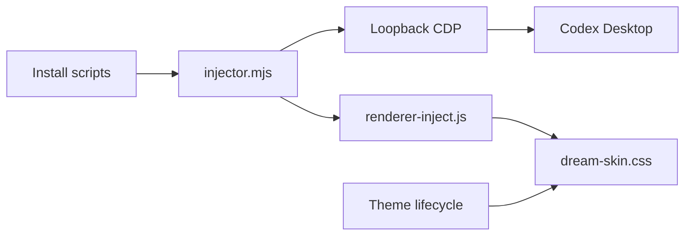

# Fei-Away/Codex-Dream-Skin

> Dresses the Codex desktop app with a custom wallpaper, without modifying the app.

## The problem
Not documented as a need: the Codex desktop interface cannot be visually customized.

## What it actually does
Injects CSS and a background through the local Chrome DevTools Protocol (CDP) into the already-running Codex process, without touching the app or its signature. On macOS (menu bar) and Windows (notification area): saved themes, validated ZIP import, one-click restore. Unofficial. A gallery site offers one-click application.

## How it is wired


## Trying it
```bash
# Pas de commande : installer le .dmg (macOS) ou le Setup.exe (Windows) depuis les Releases.
# Développeurs : macos/ → « Install Codex Dream Skin.command » ; windows/ → scripts/install-dream-skin.ps1
```

## Cost and gotchas
Free. The CDP port listens locally (127.0.0.1) but without authentication: any other process on the machine can connect to it as long as Codex is not restarted. Unsigned packages (system warning). Young repository (July 2026).

## What it is not
Not an official OpenAI tool, nor a key or provider manager.

## Alternatives
No alternative named in the README.

## For you
Pure aesthetics, with a non-negligible local attack surface: ignore.
