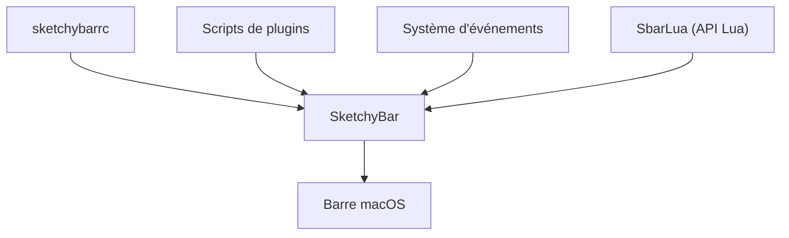

# FelixKratz/SketchyBar

> Customizable macOS menu bar driven by shell scripts, for configuration enthusiasts.

## The problem
The macOS menu bar cannot be modified, and you cannot display your own information in it.

## What it actually does
Replaces the menu bar: items can be added, removed or modified at any time, with animations, events, arbitrary graphs, context menus and mouse support. Can display native bar apps (alias). Configured through a `sketchybarrc` file and plugin scripts. The README gives no installation command.

## How it is wired
Simplified diagram based on the sheet, no diagram provided.

## Trying it
No command documented in the provided README: it points to the online installation guide.

## Cost and gotchas
Free. macOS only. Tuning takes patience with shell scripts. Last push October 2026.

## What it is not
It is not a turnkey productivity tool: without configuration, it displays very little. Nothing for Windows or Linux.

## Alternatives
No alternative named in the README (it originates from a fork of spacebar).

## For you
Desktop comfort for macOS only, unrelated to data/AI/MLOps: ignore.
