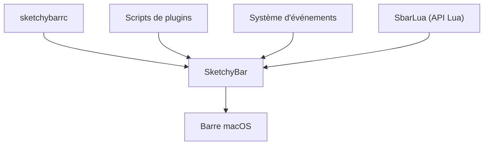

# FelixKratz/SketchyBar

> Barre de menus personnalisable pour macOS, pilotée par scripts shell, pour amateurs de configuration.

## Le problème
La barre de menus macOS n'est pas modifiable, et on ne peut pas y afficher ses propres informations.

## Ce que ça fait vraiment
Remplace la barre de menus : éléments ajoutés, retirés ou modifiés à tout moment, animations, événements, graphiques arbitraires, menus contextuels et support de la souris. Peut afficher des applis de la barre native (alias). Se configure par un fichier `sketchybarrc` et des scripts de plugins. Le README ne donne pas de commande d'installation.

## Comment c'est branché
Schéma simplifié d'après la fiche, sans diagramme fourni.

## Essayer
Aucune commande documentée dans le README fourni : il renvoie au guide d'installation en ligne.

## Coût et pièges
Gratuit. macOS uniquement. Le réglage demande de la patience en scripts shell. Dernier push octobre 2026.

## Ce que ce n'est pas
Ce n'est pas un outil de productivité clé en main : sans configuration, il n'affiche pas grand-chose. Rien pour Windows ni Linux.

## Alternatives
Aucune alternative nommée dans le README (il est issu d'un fork de spacebar).

## Pour toi
Confort de poste sous macOS uniquement, sans lien avec data/IA/MLOps : à ignorer.

