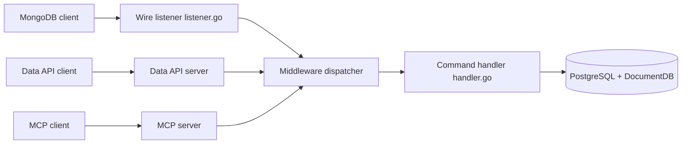

# FerretDB/FerretDB

> Open-source proxy that speaks the MongoDB protocol and stores in PostgreSQL + DocumentDB.

## The problem
MongoDB moved to the SSPL license, unusable for many open-source or commercial projects. Yet most uses only require the basic features of a document database.

## What it actually does
Translates MongoDB 5.0+ wire protocol queries into SQL executed on PostgreSQL with the DocumentDB extension.
Compatible with common MongoDB drivers and tools (mongosh), with a published list of differences.
Also exposes an HTTP Data API and an MCP server that go through the same dispatcher.
Available as a Docker image, binaries, Linux packages and an embeddable Go library.

## How it is wired


## Trying it
```bash
docker run -d --rm --name ferretdb -p 27017:27017 \
  -e POSTGRES_USER=<username> \
  -e POSTGRES_PASSWORD=<password> \
  ghcr.io/ferretdb/ferretdb-eval:2
docker exec -it ferretdb mongosh
docker stop ferretdb
```

## Cost and gotchas
Free when self-hosted. The "eval" image loses data on shutdown: follow the installation guide for production. A telemetry module exists in the code (`telemetry.go`).

## What it is not
Not a full MongoDB: compatibility "in many cases", some commands are missing. Not a standalone database: PostgreSQL + DocumentDB still have to be operated.

## Alternatives
No alternative named in the README (apart from managed offerings: FerretDB Cloud, Civo, Tembo, Elestio, Cozystack).

## For you
Worth watching: useful if an app or ML tool requires a Mongo API but you want to stay on PostgreSQL, to be validated against the list of supported commands.
