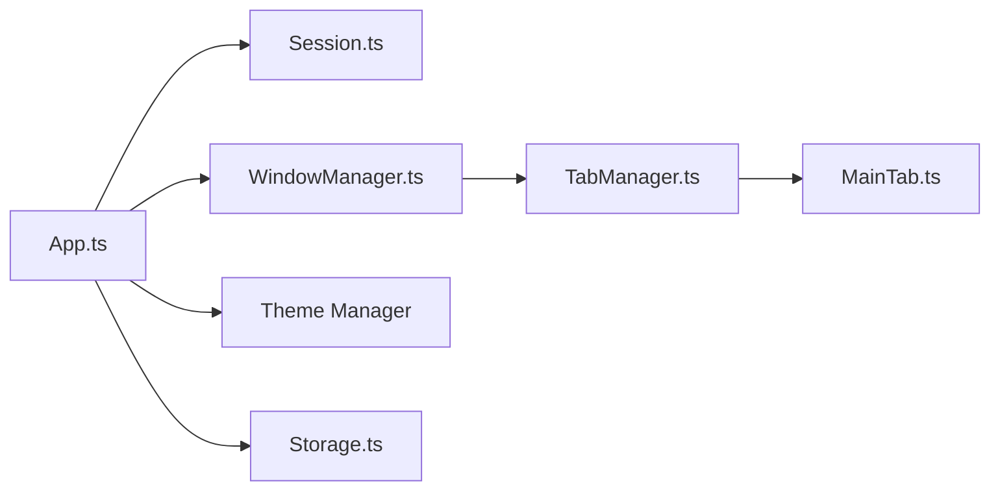

# Figma-Linux/figma-linux

> Unofficial Electron desktop client for using Figma on Linux.

## The problem
Figma has no official desktop application for Linux.

## What it actually does
Wraps Figma in Electron with managed tabs and windows, community navigation, customizable themes, local extensions, local fonts and settings. The main process handles lifecycle, tabs and persistence; the interface is in Svelte.

## How it is wired


## Trying it
```bash
sudo snap install figma-linux
```

## Cost and gotchas
Requires a Figma account. No license from Figma is provided here. Last push in January 2026.

## What it is not
Not a Figma product: unofficial application, dependent on the Figma service.

## Alternatives
- None cited in the README.

## For you
Ignore: design tool unrelated to data/AI, unless you work on Linux with Figma.
