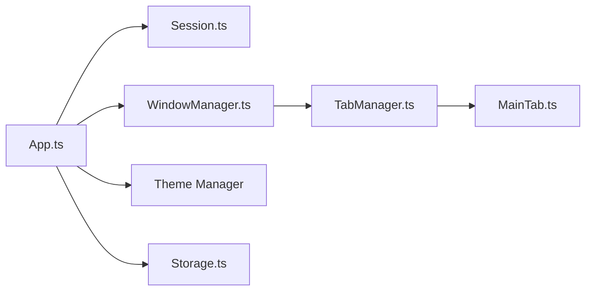

# Figma-Linux/figma-linux

> Client de bureau Electron non officiel pour utiliser Figma sous Linux.

## Le problème
Figma n'a pas d'application de bureau officielle pour Linux.

## Ce que ça fait vraiment
Enveloppe Figma dans Electron avec onglets et fenêtres gérés, navigation communautaire, thèmes personnalisables, extensions locales, polices locales et réglages. Le processus principal gère cycle de vie, onglets et persistance ; l'interface est en Svelte.

## Comment c'est branché


## Essayer
```bash
sudo snap install figma-linux
```

## Coût et pièges
Nécessite un compte Figma. Aucune licence de sa part n'est fournie ici. Dernier push en janvier 2026.

## Ce que ce n'est pas
Pas un produit de Figma : application non officielle, dépendante du service Figma.

## Alternatives
- Aucune citée dans le README.

## Pour toi
À ignorer : outil de design sans lien avec data/IA, sauf si tu travailles sous Linux avec Figma.

