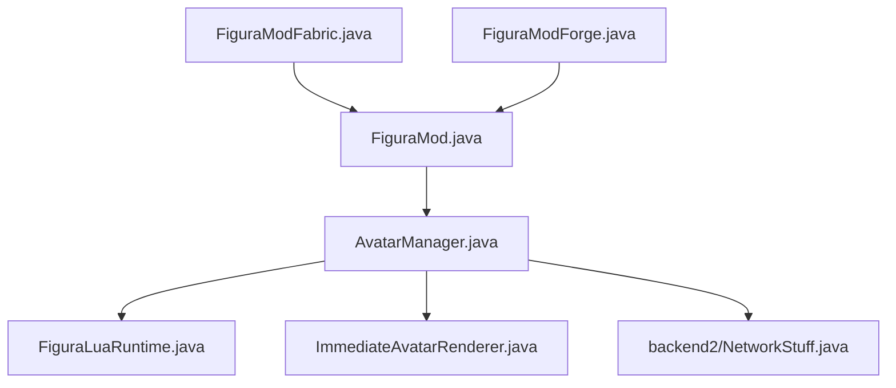

# FiguraMC/Figura

> Minecraft Java client mod to customize your player model, visible without a server-side mod.

## The problem
Minecraft skins do not change the player's shape or animation.

## What it actually does
Loads avatars created with Blockbench, with optional Lua scripts, animations, emissive textures and a permissions system. Other players see the avatar through a backend. Fabric and Forge modules on a shared codebase.

## How it is wired


## Trying it
```bash
# Aucune commande : télécharger depuis Modrinth, CurseForge ou les releases GitHub.
# Dans un script Lua d'avatar : vanilla_model.ALL:setVisible(false)
```

## Cost and gotchas
Official Minecraft account required (Mojang authentication): without it, no sending or receiving of avatars. OptiFine discouraged in favor of Sodium and Iris. License not identified.

## What it is not
Not a server mod. Not usable with an unauthenticated Minecraft.

## Alternatives
None named in the README.

## For you
Ignore: game mod unrelated to your work.
