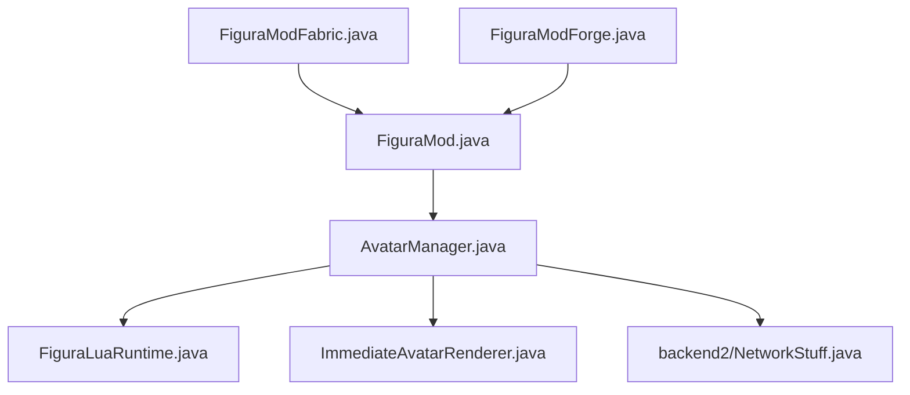

# FiguraMC/Figura

> Mod client Minecraft Java pour personnaliser son modèle de joueur, visible sans mod côté serveur.

## Le problème
Les skins Minecraft ne changent pas la forme du joueur ni son animation.

## Ce que ça fait vraiment
Charge des avatars créés avec Blockbench, avec scripts Lua optionnels, animations, textures émissives et système de permissions. Les autres joueurs voient l'avatar via un backend. Modules fabric et forge sur un code commun.

## Comment c'est branché


## Essayer
```bash
# Aucune commande : télécharger depuis Modrinth, CurseForge ou les releases GitHub.
# Dans un script Lua d'avatar : vanilla_model.ALL:setVisible(false)
```

## Coût et pièges
Compte Minecraft officiel requis (authentification Mojang) : sans lui, ni envoi ni réception d'avatars. OptiFine déconseillé au profit de Sodium et Iris. Licence non identifiée.

## Ce que ce n'est pas
Pas un mod serveur. Pas utilisable avec un Minecraft non authentifié.

## Alternatives
Aucune nommée dans le README.

## Pour toi
À ignorer : mod de jeu sans rapport avec ton métier.

