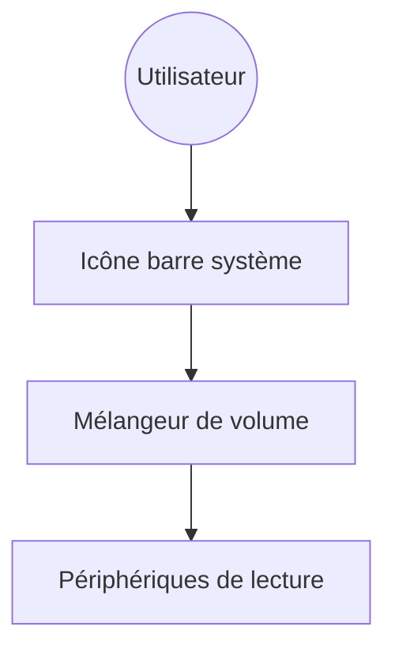

# File-New-Project/EarTrumpet

> Per-application volume mixer for Windows, in the system tray.

## The problem
Windows' native sound control handles per-application volume poorly.

## What it actually does
Shows a standalone mixer with per-channel levels, lets you move an application from one playback device to another, manage the default device, with configurable shortcuts and light/dark themes. Over 20 languages.

## How it is wired
Architecture not documented in the provided README; no diagram.


## Trying it
```bash
winget install File-New-Project.EarTrumpet
choco install eartrumpet
```

## Cost and gotchas
Free. Windows only; the README points to a page about the information collected and transmitted, not detailed here.

## What it is not
Not a data/AI tool. No Linux or macOS version. The diagram above is a schematic of the principle, not drawn from the code.

## Alternatives
None named in the README.

## For you
Ignore: a Windows desktop utility unrelated to data, AI or MLOps work.
