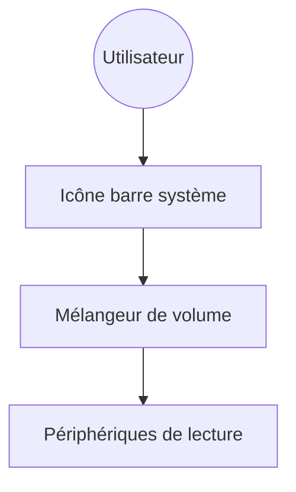

# File-New-Project/EarTrumpet

> Mélangeur de volume par application pour Windows, dans la barre système.

## Le problème
Le contrôle du son natif de Windows règle mal le volume application par application.

## Ce que ça fait vraiment
Affiche un mélangeur autonome avec niveaux par canal, permet de déplacer une application d'un périphérique de lecture à un autre, de gérer le périphérique par défaut, avec raccourcis configurables et thèmes clair/sombre. Plus de 20 langues.

## Comment c'est branché
Architecture non documentée dans le README fourni ; pas de diagramme.


## Essayer
```bash
winget install File-New-Project.EarTrumpet
choco install eartrumpet
```

## Coût et pièges
Gratuit. Windows uniquement ; le README renvoie à une page sur les informations collectées et transmises, non détaillée ici.

## Ce que ce n'est pas
Pas un outil data/IA. Pas de version Linux ou macOS. Le schéma ci-dessus est un schéma de principe, pas tiré du code.

## Alternatives
Aucune nommée dans le README.

## Pour toi
Ignorer : utilitaire de poste Windows sans lien avec un travail data, IA ou MLOps.

