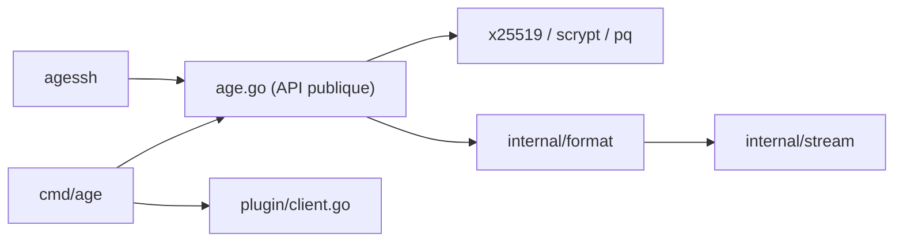

# FiloSottile/age

> Simple file encryption tool, format and Go library, with short keys and post-quantum support.

## The problem
GPG is complex and option-heavy; you need to encrypt a file or an archive with no configuration.

## What it actually does
`age` encrypts and decrypts as a stream to one or more recipients (`age1…` keys, SSH ed25519/RSA keys) or with a passphrase. `age-keygen` generates keys (`-pq` option for hybrid ML-KEM/X25519), `age-inspect` shows the metadata of an encrypted file. A plugin protocol enables YubiKey and others. The README notes that post-quantum recipients are about 2000 characters long.

## How it is wired


## Trying it
```bash
age-keygen -o key.txt
tar cvz ~/data | age -r age1ql3z7hjy54pw3hyww5ayyfg7zqgvc7w3j2elw8zmrj2kg5sfn9aqmcac8p > data.tar.gz.age
age --decrypt -i key.txt data.tar.gz.age > data.tar.gz
age -p secrets.txt > secrets.txt.age
```

## Cost and gotchas
Free. Encrypting with SSH keys adds a public-key tag to the file, which allows recipients to be traced. `ssh-agent` is not supported.

## What it is not
It is not a secrets manager or a signing system. The README does not mention key rotation.

## Alternatives
- rage: interoperable Rust implementation.
- Typage: TypeScript implementation (browser, Node, Deno, Bun).

## For you
Adopt: a good choice for encrypting datasets, backups or secrets files before storing or sharing them.
