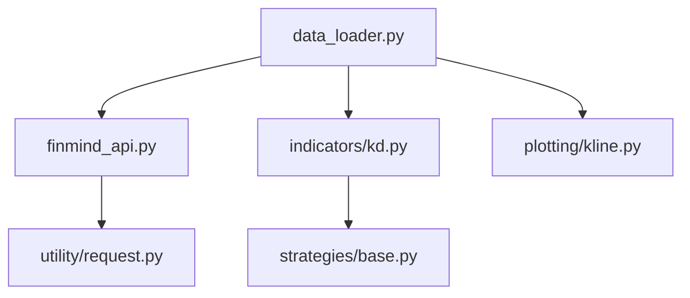

# FinMind/FinMind

> Python client and open datasets on Taiwanese and international financial markets.

## The problem
Collecting prices, financial statements and institutional flows from the Taiwanese stock exchange by hand is time-consuming.

## What it actually does
`DataLoader` queries the FinMind API (daily prices, tick data, balance sheets, chips, derivatives, US stocks, commodities, rates). Provides indicators, backtest strategies (KD) and candlestick charts. Also ships `llms.txt` for AI assistants. Limits: 300 requests/hour, 600 with a token.

## How it is wired
Diagram based on the code diagram.



## Trying it
```bash
pip install FinMind
```
```python
from FinMind.data import DataLoader
dl = DataLoader()
stock_data = dl.taiwan_stock_daily(stock_id='2609', start_date='2018-01-01', end_date='2021-06-26')
```

## Cost and gotchas
The data comes from a hosted API: hourly quota, token after registration, Sunday-morning maintenance. Exchange (TWSE) rules: broker data is for personal use only, and real-time access requires a completed profile before 2027-01-31.

## What it is not
Not a dataset you can download for offline use; not trading advice.

## Alternatives
No alternative named in the README.

## For you
Worth watching if you do quantitative finance on Taiwan: a good data source, but dependent on a third-party service.
