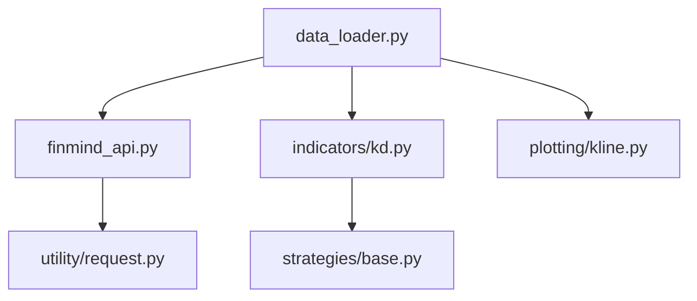

# FinMind/FinMind

> Client Python et jeux de données ouverts sur les marchés financiers de Taïwan et internationaux.

## Le problème
Collecter prix, états financiers et flux institutionnels de la bourse taïwanaise à la main est long.

## Ce que ça fait vraiment
`DataLoader` interroge l'API FinMind (cours journaliers, tick, bilans, chips, dérivés, actions américaines, matières premières, taux). Met à disposition indicateurs, stratégies de backtest (KD) et graphiques en chandeliers. Fournit aussi `llms.txt` pour assistants IA. Limites : 300 requêtes/heure, 600 avec jeton.

## Comment c'est branché
Schéma d'après le diagramme du code.



## Essayer
```bash
pip install FinMind
```
```python
from FinMind.data import DataLoader
dl = DataLoader()
stock_data = dl.taiwan_stock_daily(stock_id='2609', start_date='2018-01-01', end_date='2021-06-26')
```

## Coût et pièges
Les données viennent d'une API hébergée : quota horaire, jeton après inscription, maintenance le dimanche matin. Règles de la bourse (TWSE) : les données de courtiers sont à usage personnel et le temps réel exige un profil complété avant le 2027-01-31.

## Ce que ce n'est pas
Pas un jeu de données téléchargeable hors ligne ; pas un conseil de trading.

## Alternatives
Aucune alternative nommée dans le README.

## Pour toi
À surveiller si tu fais de la finance quantitative sur Taïwan : bonne source de données, mais sous dépendance à un service tiers.

