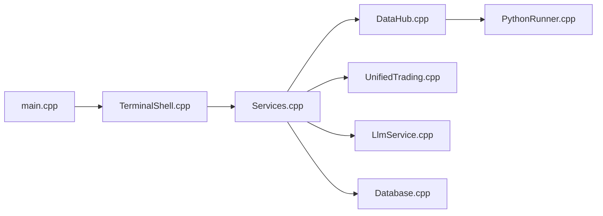

# Fincept-Corporation/FinceptTerminal

> C++/Qt desktop terminal for financial analysis with Python analytics and AI agents, AGPL edition.

## The problem
Professional financial terminals cost tens of thousands of dollars per seat.

## What it actually does
A C++20/Qt6 binary with embedded Python 3.11: DCF, portfolio optimization, VaR, derivatives, the QuantLib suite.
100+ data connectors (FRED, IMF, World Bank, Yahoo Finance, Polygon…) distributed through an internal `DataHub`.
37 AI agents (you supply the LLM key), algo engine and backtesting, paper trading, 16 brokers, node editor, MCP.
Local SQLite persistence, optional cloud sync.

## How it is wired


## Trying it
```bash
sudo apt install ./FinceptTerminal-*.deb
```
Build: `git clone … && ./setup.sh` (command truncated in the README).

## Cost and gotchas
Data and LLM at your expense, billed per token with no cap. Pinned toolchain (CMake 3.27.7, Qt 6.8.3, Python 3.11.9).

## What it is not
Not the edition developed day to day: the repository only gets one release per month, the effort goes into the closed Enterprise edition. Very commercial README.

## Alternatives
No alternative named in the README (Bloomberg is cited for price only).

## For you
A curiosity for personal quant finance; do not build on it.
