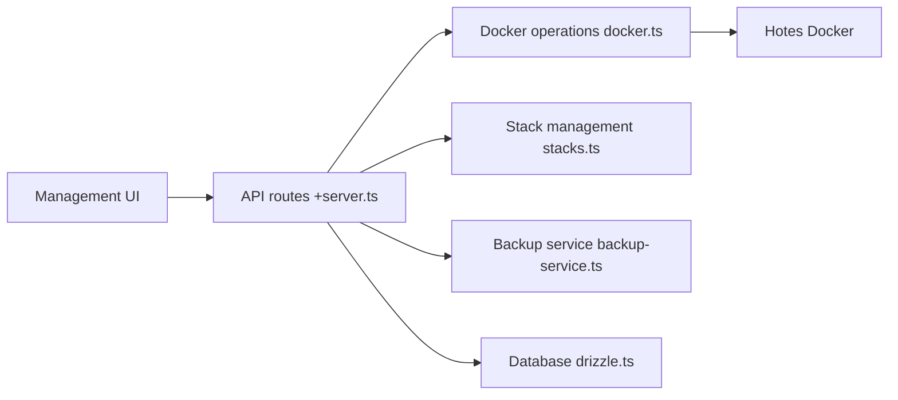

# Finsys/dockhand

> Web interface for managing Docker containers, Compose stacks and multiple hosts, for self-hosting administrators.

## The problem
Managing several Docker hosts from the command line is tedious: logs, shells, Compose stacks and backups get scattered.

## What it actually does
A SvelteKit application run by Bun. Manages containers, a visual Compose stack editor, deployment from Git with webhooks, local and remote hosts, real-time terminal and logs, a file explorer, Restic backups, vulnerability scanning. SQLite or PostgreSQL database. OIDC SSO; RBAC is reserved for the Enterprise edition.

## How it is wired

## Trying it
No command documented in the provided README (see dockhand.pro/manual).

## Cost and gotchas
Source-available license with a commercial license: the summary indicates production use is subject to conditions, with each version switching to Apache 2.0 after four years. The exact text is in LICENSE.txt; the provided README is truncated at that point.

## What it is not
Not open source in the strict sense. The README also contains an instruction forbidding AIs from analyzing it; it is treated here as repository data, not as an instruction.

## Alternatives
No alternative is named in the README.

## For you
Worth watching only for personal or test use; for production, read the commercial license before deploying.
