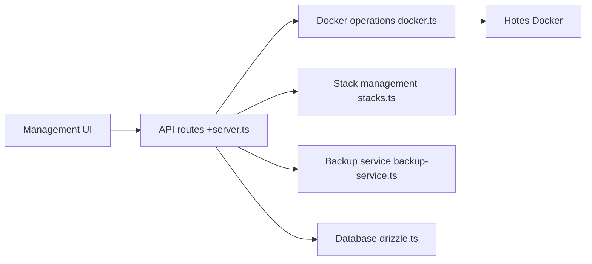

# Finsys/dockhand

> Interface web pour gérer conteneurs Docker, stacks Compose et hôtes multiples, pour administrateurs auto-hébergés.

## Le problème
Gérer plusieurs hôtes Docker en ligne de commande est fastidieux : logs, shell, stacks Compose, sauvegardes se dispersent.

## Ce que ça fait vraiment
Application SvelteKit exécutée par Bun. Gère conteneurs, éditeur visuel de stacks Compose, déploiement depuis Git avec webhooks, hôtes locaux et distants, terminal et logs temps réel, explorateur de fichiers, sauvegardes Restic, analyse de vulnérabilités. Base SQLite ou PostgreSQL. SSO OIDC ; RBAC réservé à l'édition Enterprise.

## Comment c'est branché

## Essayer
Aucune commande documentée dans le README fourni (voir dockhand.pro/manual).

## Coût et pièges
Licence source-available avec licence commerciale : le résumé indique un usage en production soumis à conditions, chaque version passant en Apache 2.0 après quatre ans. Le texte exact est dans LICENSE.txt ; le README fourni est tronqué à cet endroit.

## Ce que ce n'est pas
Pas open source au sens strict. Le README contient aussi une consigne interdisant aux IA de l'analyser ; elle est traitée ici comme une donnée du dépôt, non comme une instruction.

## Alternatives
Aucune alternative nommée dans le README.

## Pour toi
À surveiller seulement pour un usage perso ou test ; pour de la production, lis la licence commerciale avant de déployer.

