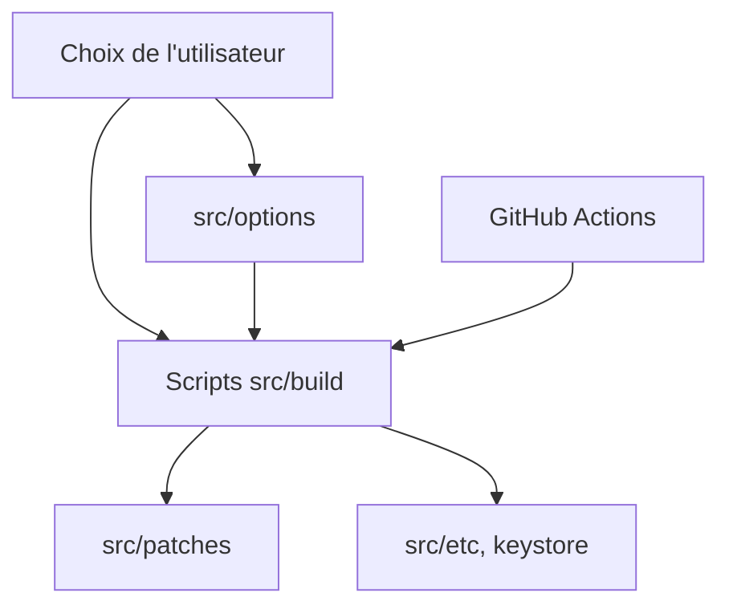

# FiorenMas/Revanced-And-Revanced-Extended-Non-Root

> Repository that publishes Android app APKs patched with ReVanced, without root access.

## The problem
ReVanced patch scripts are hard for most people to run, and each app has to be built yourself.

## What it actually does
Shell scripts (`src/build`) apply patches (`src/patches`) and options (`src/options`) to APKs, and GitHub Actions publishes the files. You choose the app (YouTube, YouTube Music, Facebook, Instagram, TikTok and others), the variant and the CPU architecture. YouTube and YouTube Music require MicroG RE.

## How it is wired


## Trying it
```bash
# Aucune commande à lancer : télécharger l'APK voulu depuis les liens du README.
```

## Cost and gotchas
Free, but you install modified third-party APKs, some of which come from authors other than the maintainer. Beta variants overwrite the Stable version with the same package name.

## What it is not
Not a data or AI tool. The patched apps may violate publishers' terms. The README accuses other projects of copying code, with no proof provided here.

## Alternatives
The upstream projects cited in the README: ReVanced, Morphe, inotia00 and anddea for the patches and the CLI.

## For you
Ignore: unrelated to a data / AI / MLOps profile, and installing patched third-party binaries carries a risk.
