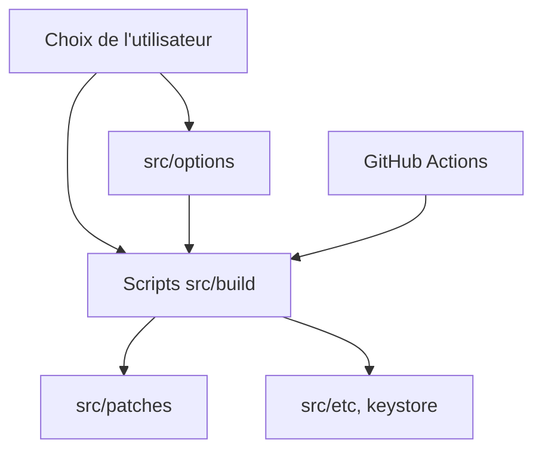

# FiorenMas/Revanced-And-Revanced-Extended-Non-Root

> Dépôt qui publie des APK d'applications Android patchées avec ReVanced, sans droits root.

## Le problème
Les scripts de patch ReVanced sont difficiles à lancer pour la plupart des gens, et il faut compiler chaque application soi-même.

## Ce que ça fait vraiment
Des scripts shell (`src/build`) appliquent des patches (`src/patches`) et des options (`src/options`) à des APK, et GitHub Actions publie les fichiers. Tu choisis l'application (YouTube, YouTube Music, Facebook, Instagram, TikTok et d'autres), la variante et l'architecture CPU. YouTube et YouTube Music demandent MicroG RE.

## Comment c'est branché


## Essayer
```bash
# Aucune commande à lancer : télécharger l'APK voulu depuis les liens du README.
```

## Coût et pièges
Gratuit, mais tu installes des APK modifiés de tiers, dont une partie vient d'autres auteurs que le mainteneur. Les variantes Beta écrasent la version Stable de même nom de paquet.

## Ce que ce n'est pas
Ce n'est pas un outil data ou IA. Les applications patchées peuvent violer les conditions des éditeurs. Le README accuse d'autres projets de copier du code, sans preuve fournie ici.

## Alternatives
Les projets amont cités dans le README : ReVanced, Morphe, inotia00 et anddea pour les patches et le CLI.

## Pour toi
À ignorer : sans rapport avec un profil data / IA / MLOps, et installer des binaires patchés de tiers présente un risque.

