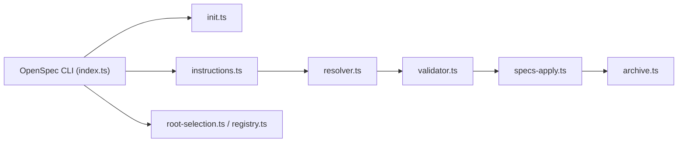

# Fission-AI/OpenSpec

> CLI that imposes a Markdown specification layer between you and your coding assistant, before any code is written.

## The problem
When requirements live only in chat history, the coding assistant becomes unpredictable and nobody knows what was decided.

## What it actually does
The flow is explore/propose → apply → archive. `/opsx:propose` creates an `openspec/changes/<name>/` folder with proposal.md, specs/, design.md, tasks.md. `/opsx:apply` runs the checklist, `/opsx:archive` merges the specs. Works with more than 30 assistants through slash commands. "Stores" (specs shared across repos) are in beta.

## How it is wired


## Trying it
```bash
npm install -g @fission-ai/openspec@latest
cd your-project
openspec init
# puis, dans ton assistant : /opsx:explore  ou  /opsx:propose <nom>
```

## Cost and gotchas
The tool is free; your assistant's tokens remain at your expense. Node.js 20.19.0 minimum. Anonymous telemetry (command names and version), which can be disabled with `openspec config set telemetry.enabled false` or `DO_NOT_TRACK=1`.

## What it is not
It is not an agent: it does not code, it structures the plan your assistant writes. The README recommends high-reasoning models and a clean context. Stores are in beta.

## Alternatives
- Spec Kit (GitHub): more formal, with rigid phases, if you want a strict framework.
- Kiro (AWS): integrated IDE, but locked into their environment and Claude.

## For you
Adopt: a spec → tasks → archive cycle versioned in git grafts onto Claude Code without changing tools, and telemetry can be turned off with a single command.
