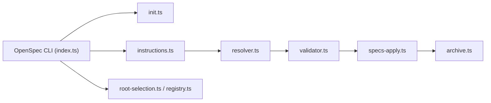

# Fission-AI/OpenSpec

> CLI qui impose une couche de spécifications Markdown entre toi et ton assistant de code, avant d'écrire du code.

## Le problème
Quand les exigences ne vivent que dans l'historique de chat, l'assistant de code devient imprévisible et personne ne sait ce qui a été décidé.

## Ce que ça fait vraiment
Le flux est explorer/proposer → appliquer → archiver. `/opsx:propose` crée un dossier `openspec/changes/<nom>/` avec proposal.md, specs/, design.md, tasks.md. `/opsx:apply` exécute la checklist, `/opsx:archive` fusionne les specs. Fonctionne avec plus de 30 assistants via des commandes slash. Les « Stores » (specs partagées entre dépôts) sont en bêta.

## Comment c'est branché


## Essayer
```bash
npm install -g @fission-ai/openspec@latest
cd your-project
openspec init
# puis, dans ton assistant : /opsx:explore  ou  /opsx:propose <nom>
```

## Coût et pièges
L'outil est gratuit ; les tokens de ton assistant restent à ta charge. Node.js 20.19.0 minimum. Télémétrie anonyme (noms de commande et version), désactivable avec `openspec config set telemetry.enabled false` ou `DO_NOT_TRACK=1`.

## Ce que ce n'est pas
Ce n'est pas un agent : il ne code pas, il structure le plan que ton assistant écrit. Le README recommande des modèles à raisonnement élevé et un contexte propre. Les Stores sont en bêta.

## Alternatives
- Spec Kit (GitHub) : plus formel, avec des phases rigides, si tu veux un cadre strict.
- Kiro (AWS) : IDE intégré, mais verrouillé sur leur environnement et Claude.

## Pour toi
À adopter : un cycle spec → tâches → archive versionné dans git se greffe sur Claude Code sans changer d'outils, et la télémétrie se coupe en une commande.

