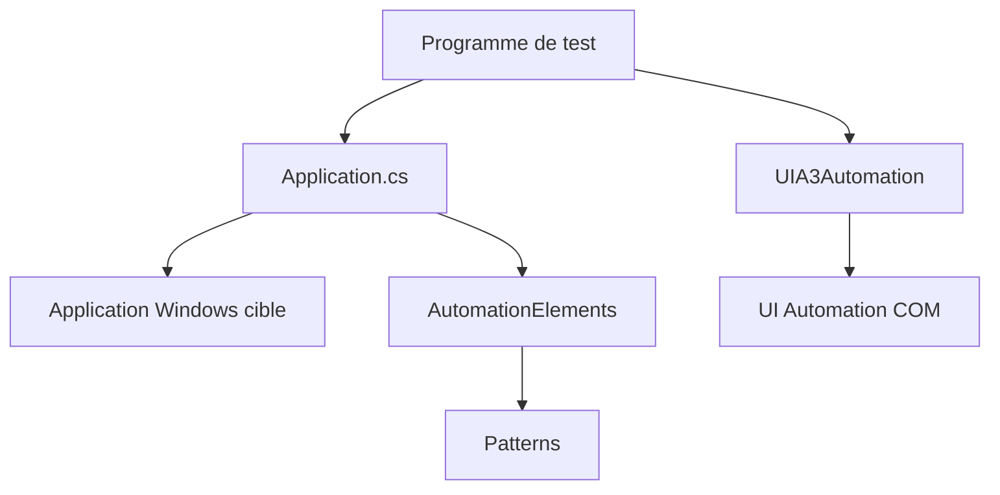

# FlaUI/FlaUI

> .NET library to automate and test the interface of Windows applications through UI Automation.

## The problem
Windows UI testing tools are commercial or rely on TestStack.White, whose old code makes UIA3 hard to use.

## What it actually does
It wraps Microsoft's UIA2 (managed) and UIA3 (COM) libraries behind a common interface. You launch or attach to an application, get the main window, look up elements with conditions, then invoke patterns or simulate keyboard, mouse and touch. It also offers screenshots and video recording.

## How it is wired


## Trying it
```bash
# Le README renvoie à NuGet sans commande ; paquet cité par ses badges :
dotnet add package FlaUI.UIA3
```

## Cost and gotchas
Free, MIT. Windows only. UIA3 may have bugs with WinForms, UIA2 handles WPF and Store applications poorly. The calculator example only works before Windows 8.

## What it is not
Not a cross-platform or web tool. Not a scenario recorder. No guarantee of completeness: the README speaks of a wrapper around almost all of UI Automation.

## Alternatives
- TestStack.White: cited, but its old code complicates UIA3.
- TestComplete, Ranorex, CodedUI: commercial solutions cited for comparison.

## For you
To ignore: testing Windows desktop applications is outside your data / AI / MLOps scope.
