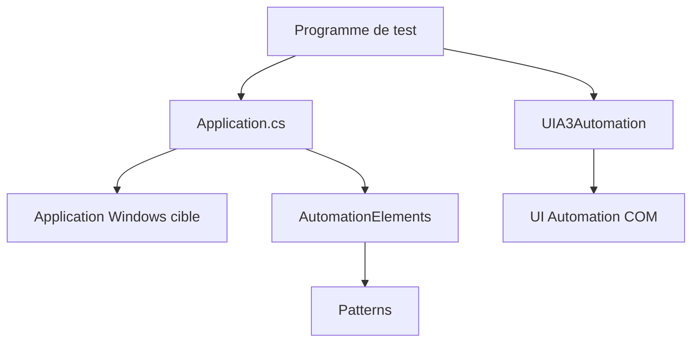

# FlaUI/FlaUI

> Bibliothèque .NET pour automatiser et tester l'interface d'applications Windows via UI Automation.

## Le problème
Les outils de test d'interface Windows sont commerciaux ou reposent sur TestStack.White, dont le code ancien rend UIA3 difficile à utiliser.

## Ce que ça fait vraiment
Elle enveloppe les bibliothèques UIA2 (managée) et UIA3 (COM) de Microsoft derrière une interface commune. Tu lances ou attaches une application, obtiens la fenêtre principale, cherches des éléments avec des conditions, puis invoques des patterns ou simules clavier, souris et tactile. Elle propose aussi captures d'écran et enregistrement vidéo.

## Comment c'est branché


## Essayer
```bash
# Le README renvoie à NuGet sans commande ; paquet cité par ses badges :
dotnet add package FlaUI.UIA3
```

## Coût et pièges
Gratuit, MIT. Windows uniquement. UIA3 peut avoir des bugs avec WinForms, UIA2 gère mal WPF et les applications du Store. L'exemple de la calculatrice ne marche qu'avant Windows 8.

## Ce que ce n'est pas
Pas un outil multiplateforme ni web. Pas d'enregistreur de scénarios. Aucune garantie d'exhaustivité : le README parle d'une enveloppe de presque tout UI Automation.

## Alternatives
- TestStack.White : cité, mais son code ancien complique UIA3.
- TestComplete, Ranorex, CodedUI : solutions commerciales citées en comparaison.

## Pour toi
À ignorer : tester des applications Windows de bureau est hors de ton périmètre data / IA / MLOps.

