# FlagOpen/FlagEmbedding

> BGE toolkit of embeddings and rerankers for search and RAG, multilingual.

## The problem
A RAG pipeline needs an embedder and a reranker that are consistent with each other, and often multilingual.
Switching from one model to another, then fine-tuning and evaluating it, is usually done with three different codebases.

## What it actually does
Loads a model through `FlagAutoModel.from_finetuned(...)`, encodes sentences, and similarity is obtained by inner product.
Embedder catalog: `bge-m3` (dense + sparse + ColBERT multi-vector, 8192 tokens), `bge-multilingual-gemma2`, `bge-en-icl` (few-shot), the `bge-*-v1.5` en/zh family, `llm-embedder`.
Cross-encoder reranker catalog: `bge-reranker-v2-m3`, `v2-gemma`, `v2-minicpm-layerwise`, `v2.5-gemma2-lightweight`, `large`, `base`.
The `[finetune]` extra adds embedder and reranker fine-tuning, plus evaluation.

## How it is wired

```mermaid
flowchart TD
  A[FlagAutoModel.from_finetuned] --> B[embedder BAAI/bge-*]
  B --> C[model.encode listes de phrases]
  C --> D[similarité produit interne]
  D --> E[reranker bge-reranker-v2-*]
  F[query_instruction_for_retrieval] --> B
  G[pip install FlagEmbedding&#91;finetune&#93;] --> H[embedder finetune / reranker finetune]
```


## Trying it
```bash
pip install -U FlagEmbedding
pip install -U FlagEmbedding[finetune]
git clone https://github.com/FlagOpen/FlagEmbedding.git
cd FlagEmbedding
pip install -e .
```

## Cost and gotchas
Free and local, no API key. The gotcha is the query instruction: each model has its own (`Represent this sentence for searching relevant passages: `, or its Chinese equivalent), and forgetting it degrades retrieval.
Cross-encoder rerankers are described as more accurate but less efficient: plan for a GPU if volume grows.

## What it is not
Not a vector database: it produces vectors, storage and indexing are elsewhere.
Not a single model but a heterogeneous catalog — LLM-based models (gemma2, minicpm) are not sized like `bge-small`.
Not a complete RAG framework: no chunking, no orchestration.

## Alternatives
- LM-Cocktail: repository/models cited for merging fine-tuned models, not for embedding itself.

## For you
It is the default starting point for multilingual open-weight embedding and reranking in a RAG.
