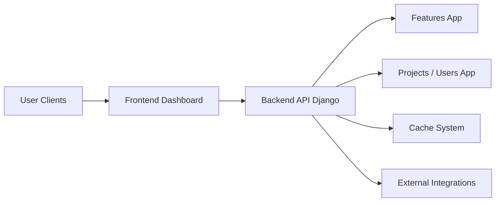

# Flagsmith/flagsmith

> Open source feature flag and remote configuration platform, self-hostable or SaaS.

## The problem
Enabling a feature for a segment, running an A/B test or cutting off a regression otherwise requires a redeployment.

## What it actually does
Django/DRF API and web dashboard to create flags, remote config values and segments.
A/B and multivariate tests per segment; organizations, projects, roles.
SDKs for 15+ languages and integrations (Slack, Datadog, GitHub…).
Enterprise governance features are under a paid license; the core remains BSD-3.

## How it is wired


## Trying it
```bash
curl -o docker-compose.yml https://raw.githubusercontent.com/Flagsmith/flagsmith/main/docker-compose.yml
docker-compose -f docker-compose.yml up
```

## Cost and gotchas
Free when self-hosted; free SaaS to try, advanced governance is paid.
719 open issues: big project, triage needed.

## What it is not
Not a full statistical experimentation tool (results analysis not documented here).
Not fully open source for the enterprise features.

## Alternatives
No alternative named in the README.

## For you
Adopt it to drive the progressive rollout of ML models or features without redeploying: mature tool, permissive license.
