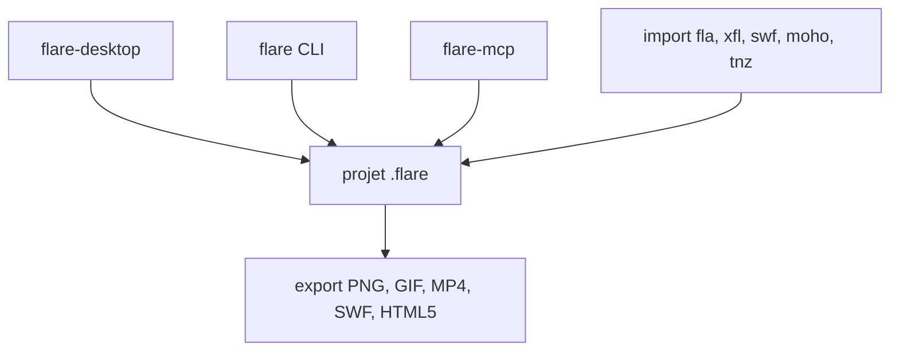

# Flare-Animate/Flare

> Free animation suite in Rust, for those coming from Adobe Animate, Flash or Moho.

## The problem
Animators depend on a single editor (Adobe Animate) and its closed project formats.

## What it actually does
Drawing, timeline, tweens, symbols, XFL and .fla import/export, SWF, Moho and OpenToonz import, PNG, GIF, MP4, SWF and HTML5 export. It also provides a `flare` command line and a `flare-mcp` MCP server for agents. Experimental web and Android version.

## How it is wired
Simplified diagram based on the sheet, no diagram provided.


## Trying it
```bash
git clone --recurse-submodules https://github.com/Flare-Animate/Flare.git
cd Flare
cargo run --release -p flare-desktop
flare new project.flare --width 1280 --height 720
```

## Cost and gotchas
No stable release: only unsigned nightlies. Rust compilation, system libraries on Linux, Ruffle as a submodule. README in early alpha: import fidelity is incomplete.

## What it is not
Not a finished replacement for Adobe Animate; no camera capture, no JPEG/WebP/PSD import.

## Alternatives
OpenToonz and Tahoma2D: the bases it derives from.

## For you
Ignore: graphic animation tool in alpha; only the MCP server is reminiscent of your domain, with no direct data/AI use.
