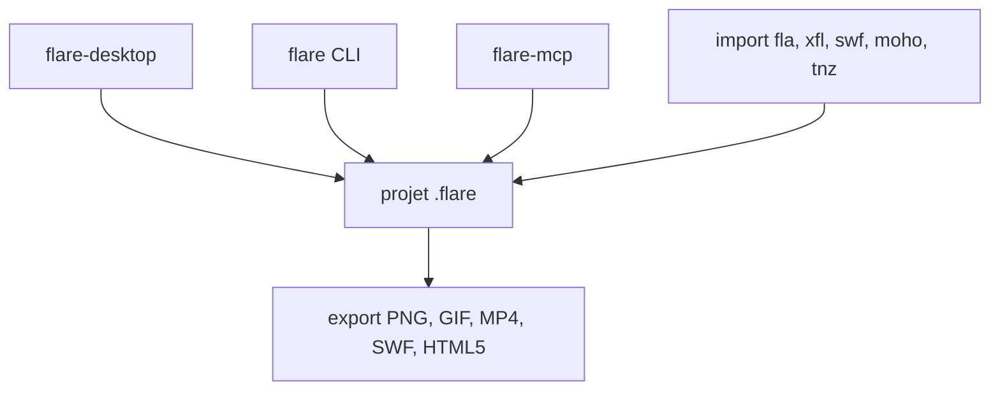

# Flare-Animate/Flare

> Suite d'animation libre en Rust, pour qui vient d'Adobe Animate, Flash ou Moho.

## Le problème
Les animateurs dépendent d'un seul éditeur (Adobe Animate) et de ses formats de projet fermés.

## Ce que ça fait vraiment
Dessin, timeline, tweens, symboles, import/export XFL et .fla, import SWF, Moho et OpenToonz, export PNG, GIF, MP4, SWF et HTML5. Il fournit aussi une ligne de commande `flare` et un serveur MCP `flare-mcp` pour agents. Version web et Android expérimentale.

## Comment c'est branché
Schéma simplifié d'après la fiche, sans diagramme fourni.


## Essayer
```bash
git clone --recurse-submodules https://github.com/Flare-Animate/Flare.git
cd Flare
cargo run --release -p flare-desktop
flare new project.flare --width 1280 --height 720
```

## Coût et pièges
Pas de version stable : seulement des nightly non signées. Compilation Rust, bibliothèques système sous Linux, Ruffle en sous-module. README en alpha précoce : fidélité d'import incomplète.

## Ce que ce n'est pas
Pas un remplaçant fini d'Adobe Animate ; pas de capture caméra, pas d'import JPEG/WebP/PSD.

## Alternatives
OpenToonz et Tahoma2D : les bases dont il est issu.

## Pour toi
À ignorer : outil d'animation graphique en alpha ; seul le serveur MCP rappelle ton domaine, sans usage data/IA direct.

