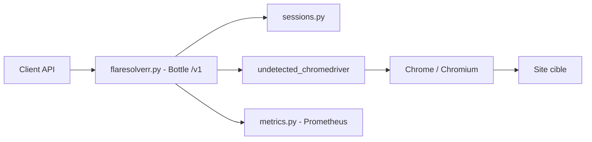

# FlareSolverr/FlareSolverr

> Local proxy server that drives a real Chrome to fetch pages and cookies behind Cloudflare or DDoS-GUARD.

## The problem
A classic HTTP client (script, scraper) is blocked by anti-bot verification pages. It needs a real browser to obtain the page and the session cookies.

## What it actually does
A JSON API on `/v1` (port 8191): `request.get`, `request.post` and persistent sessions. For each request, a Chrome is launched through Selenium and undetected-chromedriver; it waits for the challenge to finish, then returns HTML, cookies, user-agent, optionally a screenshot. The cookies can then be used by other HTTP clients, provided they reuse the same user-agent. Optional Prometheus export (port 8192).

## How it is wired


## Trying it
```bash
docker run -d \
  --name=flaresolverr \
  -p 127.0.0.1:8191:8191 \
  -e LOG_LEVEL=info \
  --restart unless-stopped \
  ghcr.io/flaresolverr/flaresolverr:latest

curl -L -X POST 'http://localhost:8191/v1' \
-H 'Content-Type: application/json' \
--data-raw '{"cmd": "request.get", "url": "http://www.google.com/", "maxTimeout": 60000}'
```

## Cost and gotchas
No key or account, but one browser per request: RAM climbs fast, and sessions must be closed (`sessions.destroy`). The README forbids exposing the service to the Internet (risk of abuse); publish it on 127.0.0.1.

## What it is not
Not a guarantee of getting through: the README states that no captcha solver currently works. It is a dual-use tool: its use must respect the terms of service and the law applicable to the targeted sites.

## Alternatives
- FlareSolverrSharp: C# implementation cited in "Related projects".

## For you
Worth watching: useful for feeding a data-collection pipeline on sources you are allowed to access, but fragile against evolving protections, RAM-hungry and without a captcha solver.
