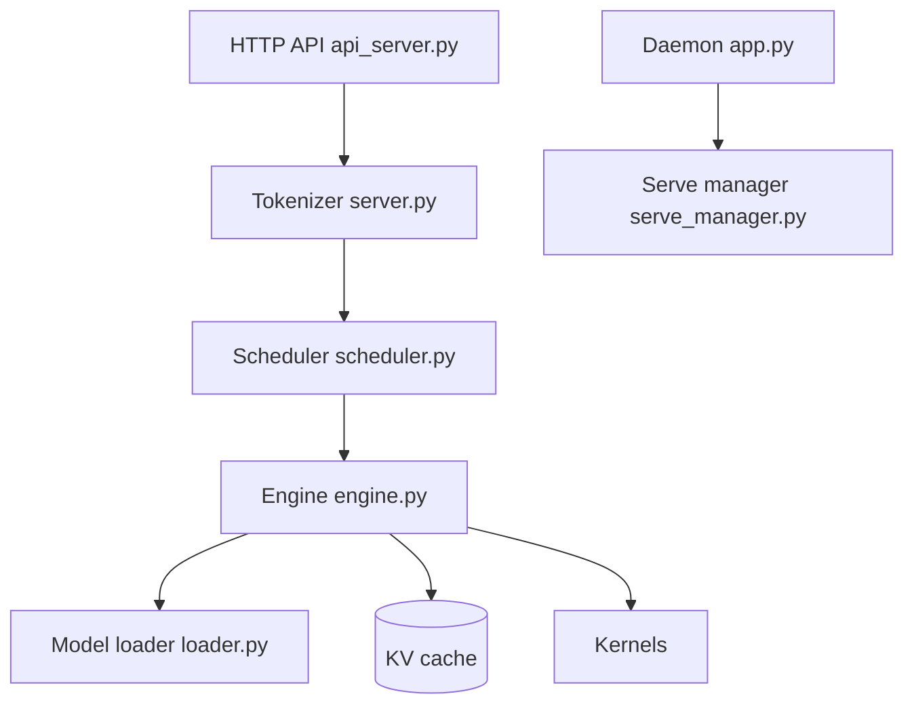

# FlashML-org/FreeToken

> Inference engine to run large MoE models locally on a gaming PC.

## The problem
Large open-weight MoE models do not fit in the VRAM of a consumer card. Without a dedicated engine, you need a datacenter server.

## What it actually does
- Serves MoE models by splitting the work between GPU and CPU, with a global LRU expert cache and layer-by-layer prefetching.
- Keeps semantic KV cache checkpoints to avoid recomputing context when an agent edits the history.
- Reallocates VRAM between the expert cache and hot KV memory, without restarting.
- Exposes Anthropic- and OpenAI-compatible APIs; targets NVIDIA RTX 30, 40 and 50 GPUs.

## How it is wired


## Trying it
```bash
uv pip install "freetoken[accel]"

git clone https://github.com/FlashML-org/FreeToken.git && cd FreeToken
uv venv && source .venv/bin/activate
uv pip install -e ".[accel]"
```
A desktop app (Windows, Linux) is also offered on flashml.ai.

## Cost and gotchas
Free software (Apache-2.0), but you need an RTX GPU and host memory; the exact requirements per model are not in the README. 470 open issues for a repository created in July 2026.

## What it is not
Not a model: a serving engine. The announced performance ("interactive speeds" for 290B+) is not quantified in the README. Reuses code from mini-sglang, SGLang, vLLM and others.

## Alternatives
- vLLM: the serving reference, more established.
- SGLang: same family, direct source of inspiration.
- llama.cpp: general-purpose local inference, named in the acknowledgments.

## For you
Worth watching: useful if you want to test very large MoEs on your machine, but young and not measured in the README, so benchmark before relying on it.
