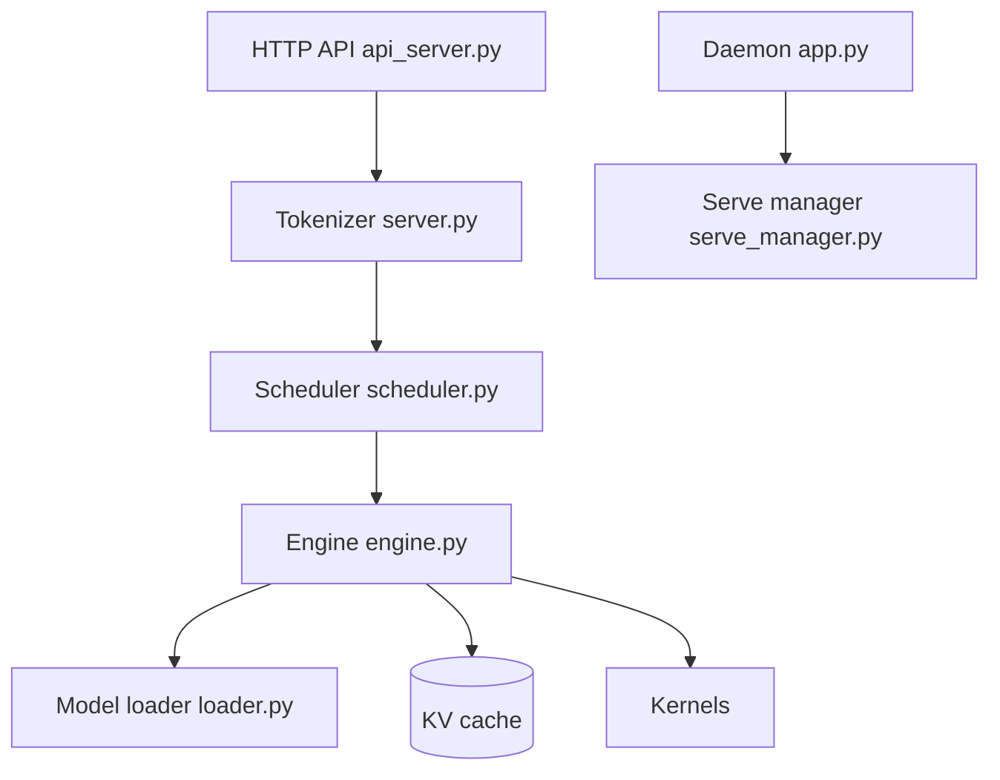

# FlashML-org/FreeToken

> Moteur d'inférence pour faire tourner localement de gros modèles MoE sur un PC de joueur.

## Le problème
Les gros modèles MoE open-weight ne tiennent pas dans la VRAM d'une carte grand public. Sans moteur dédié, il faut un serveur de datacenter.

## Ce que ça fait vraiment
- Sert des modèles MoE en répartissant le travail entre GPU et CPU, avec un cache LRU global des experts et un préchargement par couches.
- Garde des points de contrôle sémantiques du cache KV pour éviter de recalculer le contexte quand un agent édite l'historique.
- Réalloue la VRAM entre cache d'experts et mémoire KV à chaud, sans redémarrer.
- Expose des API compatibles Anthropic et OpenAI ; cible les GPU NVIDIA RTX 30, 40 et 50.

## Comment c'est branché


## Essayer
```bash
uv pip install "freetoken[accel]"

git clone https://github.com/FlashML-org/FreeToken.git && cd FreeToken
uv venv && source .venv/bin/activate
uv pip install -e ".[accel]"
```
Une app de bureau (Windows, Linux) est aussi proposée sur flashml.ai.

## Coût et pièges
Logiciel gratuit (Apache-2.0), mais il faut un GPU RTX et de la mémoire hôte ; les besoins exacts par modèle ne sont pas dans le README. 470 issues ouvertes pour un dépôt créé en juillet 2026.

## Ce que ce n'est pas
Pas un modèle : un moteur de service. Les performances annoncées (« vitesses interactives » pour 290B+) ne sont pas chiffrées dans le README. Réutilise du code de mini-sglang, SGLang, vLLM et d'autres.

## Alternatives
- vLLM : référence de service, plus établie.
- SGLang : même famille, source d'inspiration directe.
- llama.cpp : inférence locale généraliste, nommée dans les remerciements.

## Pour toi
À surveiller : utile si tu veux tester des MoE de très grande taille sur ta machine, mais jeune et non mesuré dans le README, donc à benchmarker avant d'y compter.

