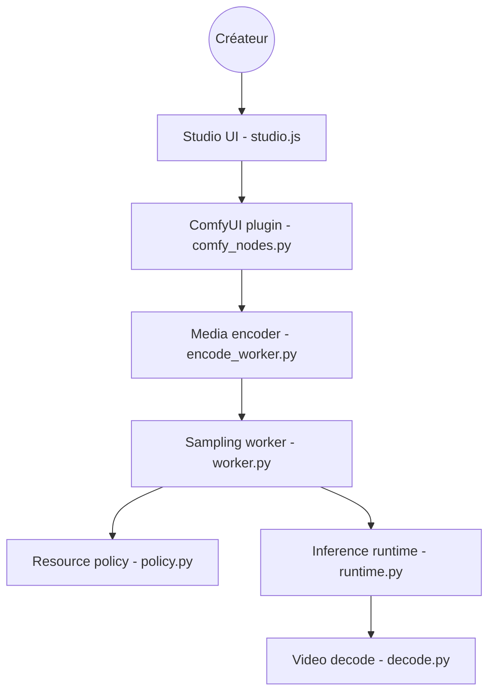

# FlashML-org/FreeVideo

> Local MiniMax H3 video generation engine under ComfyUI, designed for consumer GPUs.

## The problem
Video generation models usually require big GPUs. Generating video on your own machine is out of reach.

## What it actually does
Runs MiniMax H3 (VDN-H3 model, Video DeltaNet hybrid attention) with 8 GB of VRAM and 16 GB of RAM, using weight streaming, asynchronous prefetching and block-wise computation. Chooses int8 or FP8 depending on the card. Supports text, first and last frame, image, video and audio references, as well as community LoRAs. Used as a ComfyUI plugin with Windows, macOS (Apple silicon preview) and Linux launchers.

## How it is wired


## Trying it
```bash
cd ComfyUI/custom_nodes
git clone https://github.com/FlashML-org/FreeVideo.git
git clone https://github.com/FlashML-org/FreeVideo.git && cd FreeVideo
./setup.sh
freevideo
```
The first command installs the node into an existing ComfyUI; the following ones are for the Linux installation.

## Cost and gotchas
Free, but several model packs must be downloaded and a GPU is required. The macOS version is a non-notarized preview, tested on a 24 GB M5 Mac. The Windows executable may be blocked by an antivirus: check the SHA-256. 743 open issues.

## What it is not
Not an online service nor a new model: a runtime engine around a third-party model. Results vary depending on the machine.

## Alternatives
No alternative named in the README.

## For you
Worth watching if you want to test video generation locally; test on your own card before promising anything.
