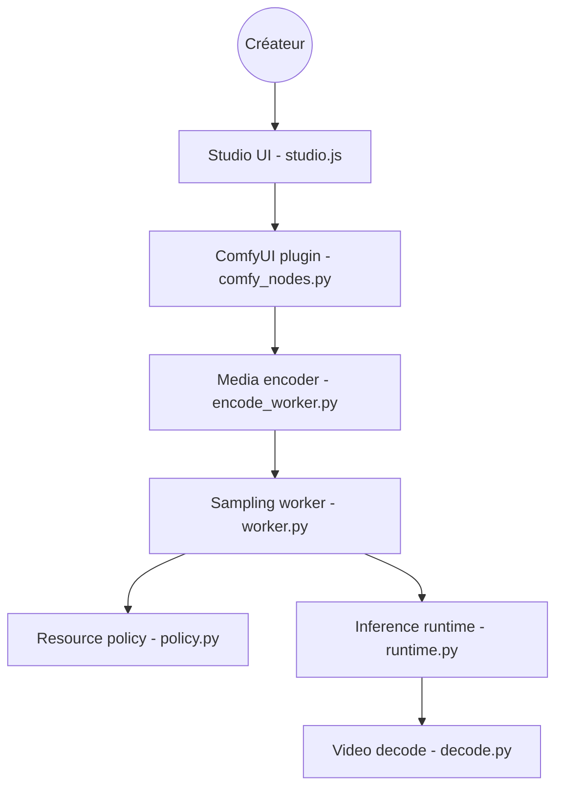

# FlashML-org/FreeVideo

> Moteur local de génération vidéo MiniMax H3 sous ComfyUI, pensé pour des GPU grand public.

## Le problème
Les modèles de génération vidéo exigent habituellement de gros GPU. Faire de la vidéo sur sa propre machine est hors de portée.

## Ce que ça fait vraiment
Fait tourner MiniMax H3 (modèle VDN-H3, attention hybride Video DeltaNet) avec 8 Go de VRAM et 16 Go de RAM, en jouant sur le streaming de poids, le préchargement asynchrone et le calcul par blocs. Choisit int8 ou FP8 selon la carte. Prend en charge texte, première et dernière image, références image, vidéo et audio, ainsi que des LoRA communautaires. S'utilise comme plugin ComfyUI avec lanceurs Windows, macOS (aperçu Apple silicon) et Linux.

## Comment c'est branché


## Essayer
```bash
cd ComfyUI/custom_nodes
git clone https://github.com/FlashML-org/FreeVideo.git
git clone https://github.com/FlashML-org/FreeVideo.git && cd FreeVideo
./setup.sh
freevideo
```
La première commande installe le nœud dans un ComfyUI existant ; les suivantes servent l'installation Linux.

## Coût et pièges
Gratuit, mais téléchargement de plusieurs packs de modèles et GPU nécessaire. La version macOS est un aperçu non notarisé, testée sur un Mac M5 de 24 Go. L'exécutable Windows peut être bloqué par un antivirus : vérifier le SHA-256. 743 issues ouvertes.

## Ce que ce n'est pas
Pas un service en ligne ni un modèle nouveau : un moteur d'exécution autour d'un modèle tiers. Les résultats varient selon la machine.

## Alternatives
Aucune alternative nommée dans le README.

## Pour toi
À surveiller si tu veux tester la génération vidéo en local ; teste sur ta carte avant de promettre quoi que ce soit.

