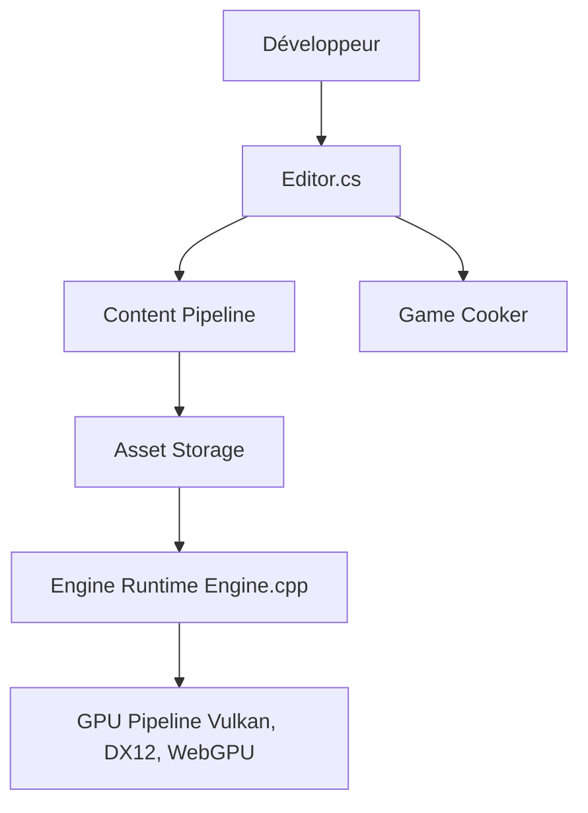

# FlaxEngine/FlaxEngine

> 3D game engine in C++ and C# with a built-in editor, to be built from source.

## The problem
Making a 3D game requires an engine, an editor, a content pipeline and cross-platform rendering.

## What it actually does
Provides the full engine source code (except NDA-restricted platforms), a scene and asset editor, C# and C++ scripting, rendering through Vulkan, DirectX 12 and WebGPU backends, and a "game cooker" that produces the game data per platform. Documentation lives in a separate repository.

## How it is wired
Diagram taken from the code, reduced.



## Trying it
```bash
git-lfs clone https://github.com/FlaxEngine/FlaxEngine.git
./GenerateProjectFiles.sh
```
On Windows: `GenerateProjectFiles.bat`, then open `Flax.slnx` in Visual Studio.

## Cost and gotchas
Free to build but heavy: Visual Studio 2026 or Clang 14+, .NET 10 SDK, Git LFS, Vulkan SDK on Linux. The license is a proprietary EULA (GitHub does not identify it); 819 open issues.

## What it is not
Not open source in the usual sense: use of the code is governed by the engine's EULA. Not a data or AI tool.

## Alternatives
No alternative named in the README.

## For you
Ignore: a game engine outside your scope, under a license to read closely.
