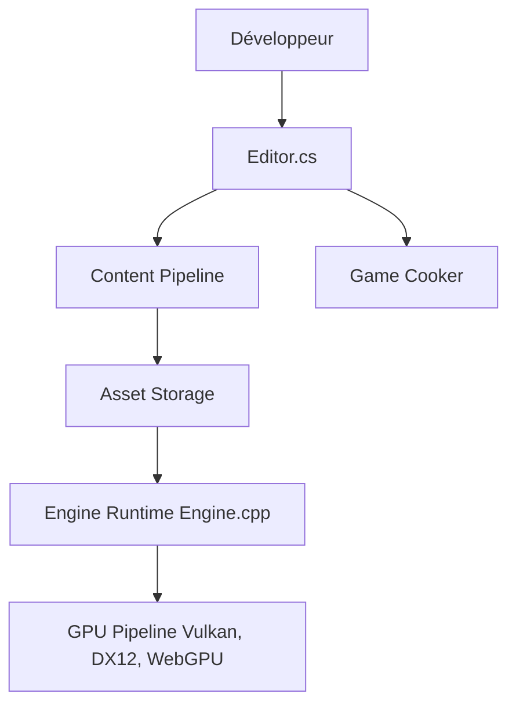

# FlaxEngine/FlaxEngine

> Moteur de jeu 3D en C++ et C# avec éditeur intégré, à compiler depuis les sources.

## Le problème
Créer un jeu 3D demande un moteur, un éditeur, un pipeline de contenu et un rendu multiplateforme.

## Ce que ça fait vraiment
Fournit le code source complet du moteur (hors plateformes sous NDA), un éditeur de scènes et d'assets, des scripts C# et C++, un rendu via backends Vulkan, DirectX 12 et WebGPU, et un « game cooker » qui produit les données du jeu par plateforme. Documentation dans un dépôt séparé.

## Comment c'est branché
Diagramme tiré du code, réduit.



## Essayer
```bash
git-lfs clone https://github.com/FlaxEngine/FlaxEngine.git
./GenerateProjectFiles.sh
```
Sous Windows : `GenerateProjectFiles.bat`, puis ouvrir `Flax.slnx` dans Visual Studio.

## Coût et pièges
Gratuit à compiler mais lourd : Visual Studio 2026 ou Clang 14+, .NET 10 SDK, Git LFS, Vulkan SDK sous Linux. La licence est une EULA propriétaire (GitHub ne l'identifie pas) ; 819 issues ouvertes.

## Ce que ce n'est pas
Pas open source au sens usuel : l'usage du code est régi par l'EULA du moteur. Pas un outil de data ou d'IA.

## Alternatives
Aucune alternative nommée dans le README.

## Pour toi
À ignorer : moteur de jeu hors de ton périmètre, sous licence à lire de près.

