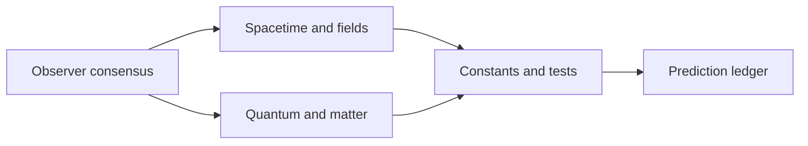

# FloatingPragma/observer-patch-holography

> Research program aiming at a theory of everything built from finite observers, with papers, Lean proofs and simulations.

## The problem
The repository tries to derive quantum mechanics, thermodynamics, spacetime and physical constants from a small number of axioms.

## What it actually does
Gathers TeX papers, a book, manuals, certificate code (exact rational arithmetic), Lean theorems (more than 11,300 claimed) and a claims registry. Three axioms: an observer screen with twelve ports, observer agreement, conditional maximal randomness. The authors classify each result (exact theorem, observation, open interface) and acknowledge that the match on the fine-structure constant remains "diagnostic".

## How it is wired


## Trying it
```bash
python3 tools/check_claim_registry.py
python3 -m pytest -q code/a5_closure/test_audit.py code/capacity_readback/test_correctable_public_record_capacity.py
```
The README lists five test files; full reproduction is in a separate guide.

## Cost and gotchas
Few declared dependencies, but the reproduction guide is not in the README. The claims are the author's own: no external validation is cited.

## What it is not
Not software and not a data tool. The README states that the approach does not claim that human thought creates reality. A non-consensus physics theory.

## Alternatives
No alternative cited in the README.

## For you
Ignore: theoretical physics research unrelated to data / AI / MLOps work, with an unrecognized license and unvalidated results.
