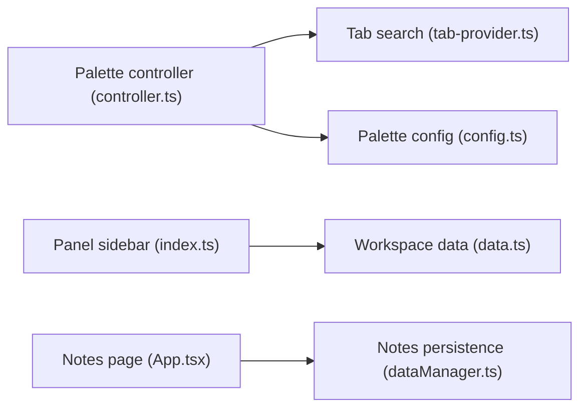

# Floorp-Projects/Floorp

> Desktop browser derived from Firefox, with workspace tabs and a command palette.

## The problem
Mainstream browsers offer little interface customization and tab organization.

## What it actually does
Firefox fork (MPL-2.0) with a command palette (tabs, bookmarks, history), panel sidebar, workspaces, split view, pinned tabs, notes page, profile manager. Installers for Windows (signed), macOS (notarized), Linux (PPA, Flatpak, tarball). Build chain via Deno (`feles-build`).

## How it is wired


## Trying it
```bash
winget install Ablaze.Floorp
brew install --cask floorp
```

## Cost and gotchas
Free. Windows 10+ x86_64 only; a privacy policy exists, detail not specified in the README (telemetry alert out of caution, unproven).

## What it is not
Not affiliated with Mozilla. No link to data/AI.

## Alternatives
None named (Firefox is the base).

## For you
Ignore: a browser is not part of your data/AI/MLOps watch; Firefox is enough.
