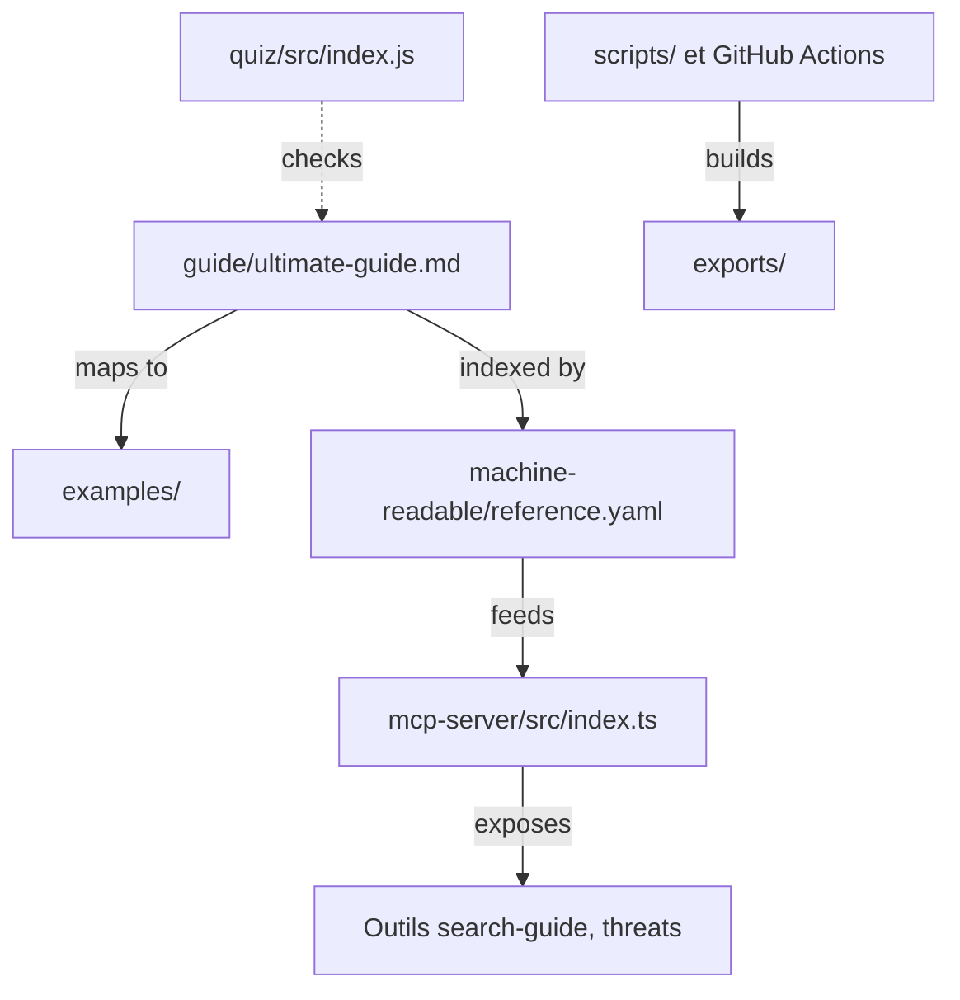

# FlorianBruniaux/claude-code-ultimate-guide

> Markdown guide to Claude Code: context, agents, security, costs, with examples and an MCP server.

## The problem
The official documentation explains the product, not the engineering choices: what to put in context, when to prefer an agent over a skill, how to frame team usage.

## What it actually does
The repository contains the guide's sources (`guide/` folder), a library of example agents, hooks and skills, a command-line quiz and machine-readable indexes. A TypeScript MCP server, launched through `npx`, exposes tools to search the guide, examples, threats and the changelog.

## How it is wired


## Trying it
```bash
claude mcp add --scope user claude-code-guide -- npx -y claude-code-ultimate-guide-mcp@1.3.7
claude --version
claude doctor
```

## Cost and gotchas
Free, CC-BY-SA-4.0 license (share-alike). Some MCP server tools fetch content from GitHub or the Anthropic documentation and write a 24-hour local cache. A single maintainer.

## What it is not
It is not a tool for installing configurations: the README points to other repositories for that. The Chinese, Ukrainian and Spanish translations are independent community editions.

## Alternatives
The README cites awesome-claude-code, everything-claude-code, claude-code-templates and anthropics/skills.

## For you
Worth adopting if you code with Claude Code: a structured reference on context, security and costs, also usable as an MCP server.
