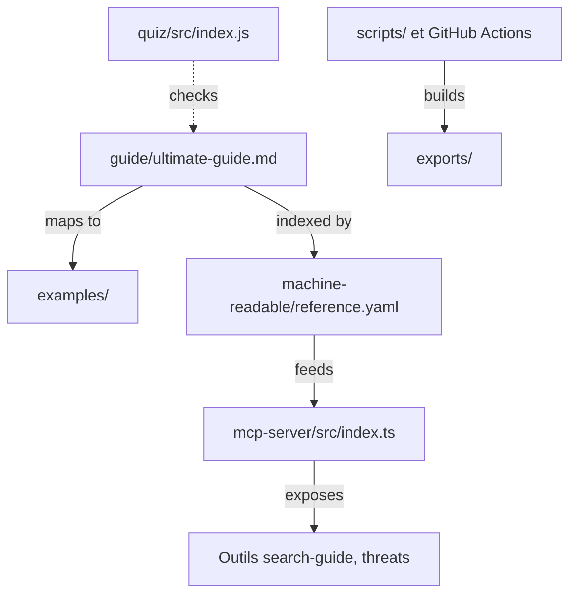

# FlorianBruniaux/claude-code-ultimate-guide

> Guide Markdown sur Claude Code : contexte, agents, sécurité, coûts, avec exemples et serveur MCP.

## Le problème
La documentation officielle explique le produit, pas les choix d'ingénierie : quoi mettre en contexte, quand préférer un agent à un skill, comment cadrer l'usage en équipe.

## Ce que ça fait vraiment
Le dépôt contient les sources du guide (dossier `guide/`), une bibliothèque d'exemples d'agents, hooks et skills, un quiz en ligne de commande et des index lisibles par machine. Un serveur MCP en TypeScript, lancé par `npx`, expose des outils de recherche dans le guide, d'exemples, de menaces et de changelog.

## Comment c'est branché


## Essayer
```bash
claude mcp add --scope user claude-code-guide -- npx -y claude-code-ultimate-guide-mcp@1.3.7
claude --version
claude doctor
```

## Coût et pièges
Gratuit, licence CC-BY-SA-4.0 (partage à l'identique). Certains outils du serveur MCP récupèrent du contenu sur GitHub ou la documentation Anthropic et écrivent un cache local de 24 heures. Un seul mainteneur.

## Ce que ce n'est pas
Ce n'est pas un outil d'installation de configurations : le README renvoie vers d'autres dépôts pour cela. Les traductions chinoise, ukrainienne et espagnole sont des éditions communautaires indépendantes.

## Alternatives
Le README cite awesome-claude-code, everything-claude-code, claude-code-templates et anthropics/skills.

## Pour toi
À adopter si tu codes avec Claude Code : référence structurée sur contexte, sécurité et coûts, utilisable aussi comme serveur MCP.

