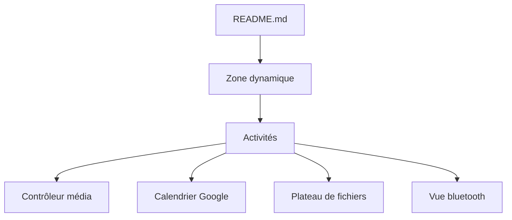

# FlorianButz/DynamicWin

> Windows app in the style of Dynamic Island with a media player, calendar, bluetooth and a file drop zone.

## The problem
Windows has no equivalent of macOS dynamic notches for grouping media and shortcuts.

## What it actually does
A dynamic area at the top of the screen that switches by scrolling between a media controller, a Google calendar, a file tray (run, Windows sharing) and bluetooth status with battery. The README states that there is no source code in the repository, only the releases.

## How it is wired

## Trying it
No command in the README: download the executable from the Releases.

## Cost and gotchas
Free. The calendar depends on Google Calendar. Last push in October 2025. Closed binaries: the code is not published.

## What it is not
Not an auditable project: the CC-BY-SA-4.0 licence is declared, but the repository contains no code.

## Alternatives
No alternative named in the README, apart from NotchNook cited as the macOS equivalent.

## For you
Ignore: a Windows desktop gadget with unpublished code, of no interest for data, AI or MLOps work.
