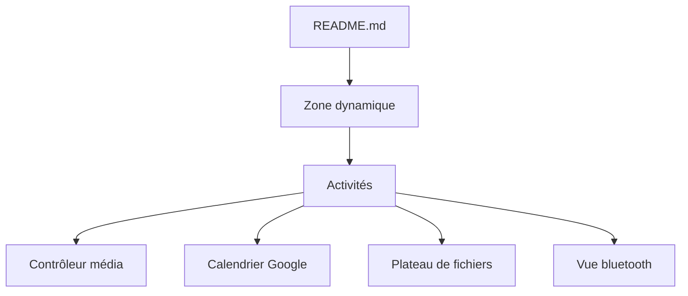

# FlorianButz/DynamicWin

> Application Windows façon Dynamic Island avec lecteur média, calendrier, bluetooth et zone de dépôt de fichiers.

## Le problème
Windows n'a pas d'équivalent aux encoches dynamiques de macOS pour regrouper médias et raccourcis.

## Ce que ça fait vraiment
Une zone dynamique en haut de l'écran qui bascule par défilement entre un contrôleur média, un calendrier Google, un plateau de fichiers (exécution, partage Windows) et l'état bluetooth avec la batterie. Le README précise qu'il n'y a aucun code source dans le dépôt, seulement les versions.

## Comment c'est branché

## Essayer
Aucune commande dans le README : télécharger l'exécutable depuis les Releases.

## Coût et pièges
Gratuit. Le calendrier dépend de Google Calendar. Dernier push en octobre 2025. Binaires fermés : le code n'est pas publié.

## Ce que ce n'est pas
Pas un projet auditable : la licence CC-BY-SA-4.0 est déclarée, mais le dépôt ne contient aucun code.

## Alternatives
Aucune alternative nommée dans le README, hormis NotchNook cité comme équivalent macOS.

## Pour toi
À ignorer : gadget de bureau Windows à code non publié, sans intérêt pour un travail data, IA ou MLOps.

