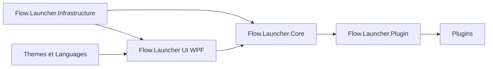

# Flow-Launcher/Flow.Launcher

> Fast launcher and search engine for Windows, extensible with community plugins.

## The problem
Finding an app, a file, a bookmark or a system command means digging through Explorer or the Start menu.

## What it actually does
A window summoned with Alt+Space searches apps, files (Everything or the Windows index), bookmarks, Windows settings, calculations and shell commands. Results come from dynamically loaded plugins (C#, Python, JS, TS). Preview with F1, themes, game mode, Dialog Jump for Open/Save windows.

## How it is wired


## Trying it
```bash
winget install "Flow Launcher"
scoop install Flow-Launcher
choco install Flow-Launcher
```

## Cost and gotchas
Free. Windows 10+ only. The code is not signed: Windows may show a warning on first installation. Beware of fake sites: only the official channels are trustworthy.

## What it is not
Not cross-platform. Not an indexer of its own: it relies on Everything or the Windows index. Third-party plugins are as good as their author makes them.

## Alternatives
No alternative named in the README.

## For you
Adopt if your workstation runs Windows: daily time saver with no risk, MIT, very active (15,855 stars, push of 2026-10-21); of no interest on Linux or macOS.
