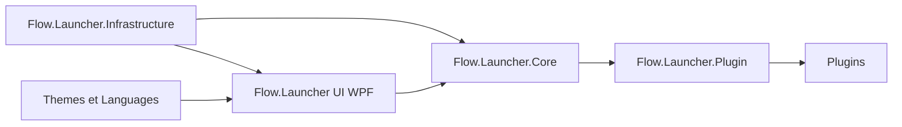

# Flow-Launcher/Flow.Launcher

> Lanceur et moteur de recherche rapide pour Windows, extensible par des plugins communautaires.

## Le problème
Retrouver une appli, un fichier, un favori ou une commande système oblige à fouiller l'Explorateur ou le menu Démarrer.

## Ce que ça fait vraiment
Une fenêtre appelée par Alt+Espace cherche applis, fichiers (Everything ou index Windows), favoris, réglages Windows, calculs et commandes shell. Les résultats viennent de plugins chargés dynamiquement (C#, Python, JS, TS). Aperçu par F1, thèmes, mode jeu, Dialog Jump pour les fenêtres Ouvrir/Enregistrer.

## Comment c'est branché


## Essayer
```bash
winget install "Flow Launcher"
scoop install Flow-Launcher
choco install Flow-Launcher
```

## Coût et pièges
Gratuit. Windows 10+ uniquement. Le code n'est pas signé : Windows peut afficher un avertissement à la première installation. Se méfier des faux sites : seuls les canaux officiels sont fiables.

## Ce que ce n'est pas
Pas multiplateforme. Pas un indexeur propre : il s'appuie sur Everything ou l'index Windows. Les plugins tiers ont la qualité que leur auteur leur donne.

## Alternatives
Aucune alternative nommée dans le README.

## Pour toi
Adopter si ton poste est sous Windows : gain de temps quotidien sans risque, MIT, très actif (15 855 étoiles, push du 2026-10-21) ; sans intérêt sous Linux ou macOS.

