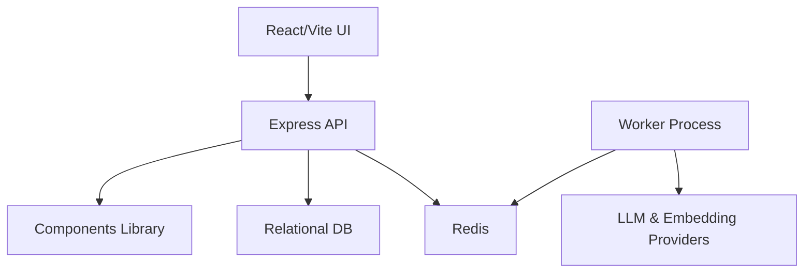

# FlowiseAI/Flowise

> Visual agent builder, self-hosted, now archived by its creators.

## The problem
Creating chains and agents using LLMs requires code; a visual editor lowers the barrier to entry.

## What it actually does
Monorepo: `ui` (React), `server` (Express, TypeORM on SQLite, MySQL, or Postgres), `components` (LLM integration nodes, loaders, tools), and Swagger documentation. A Redis worker processes predictions in a queue. Prometheus and OpenTelemetry metrics.

## How it is wired


## Trying it
```bash
npm install -g flowise
npx flowise start
# puis http://localhost:3000
docker compose up -d
```

## Cost and gotchas
Free, but the LLM providers you use remain your responsibility. Node 20 or higher is required. Building from source may exceed memory (error 134): set `NODE_OPTIONS`.

## What it is not
This is no longer an active project: the README indicates that it has been archived. Archived repository, no further updates are expected.

## Alternatives
No alternative is specified in the README.

## For you
To be ignored: archived, so it will not receive any future security updates; it's preferable to use a tool that is actively maintained.
