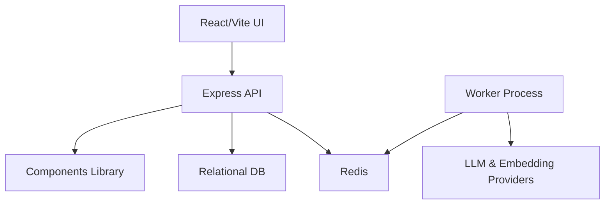

# FlowiseAI/Flowise

> Constructeur visuel d'agents IA, auto-hébergeable, désormais archivé par ses auteurs.

## Le problème
Assembler des chaînes et agents LLM demande du code ; un éditeur visuel abaisse la barrière.

## Ce que ça fait vraiment
Monorepo : `ui` (React), `server` (Express, TypeORM sur SQLite, MySQL ou Postgres), `components` (nœuds d'intégration LLM, loaders, outils) et documentation Swagger. Un worker Redis traite les prédictions en file. Métriques Prometheus et OpenTelemetry.

## Comment c'est branché


## Essayer
```bash
npm install -g flowise
npx flowise start
# puis http://localhost:3000
docker compose up -d
```

## Coût et pièges
Gratuit, mais les fournisseurs LLM utilisés restent à ta charge. Node 20 ou plus requis. Le build depuis les sources peut dépasser la mémoire (code 134) : relever `NODE_OPTIONS`.

## Ce que ce n'est pas
Ce n'est plus un projet vivant : le README annonce l'archivage. Dépôt archivé, plus de correctifs attendus.

## Alternatives
Aucune alternative nommée dans le README.

## Pour toi
À ignorer : archivé, donc sans correctifs de sécurité futurs ; préfère un outil maintenu.

